# Git Workflow Diagrams

This document contains visual diagrams for the git workflow processes and mobile KiloCode integration.

## Branching Strategy Flow

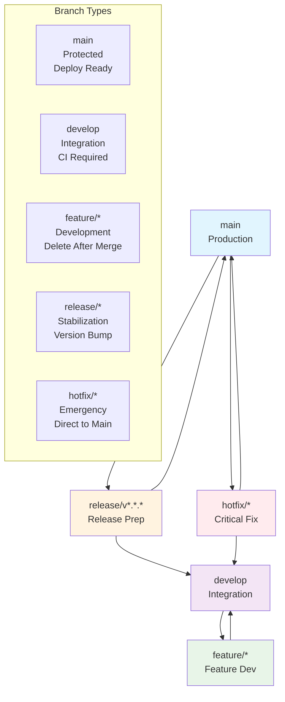

## Feature Development Workflow

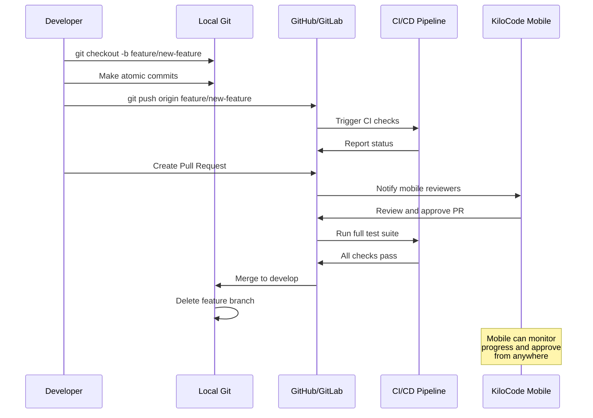

## Release Workflow

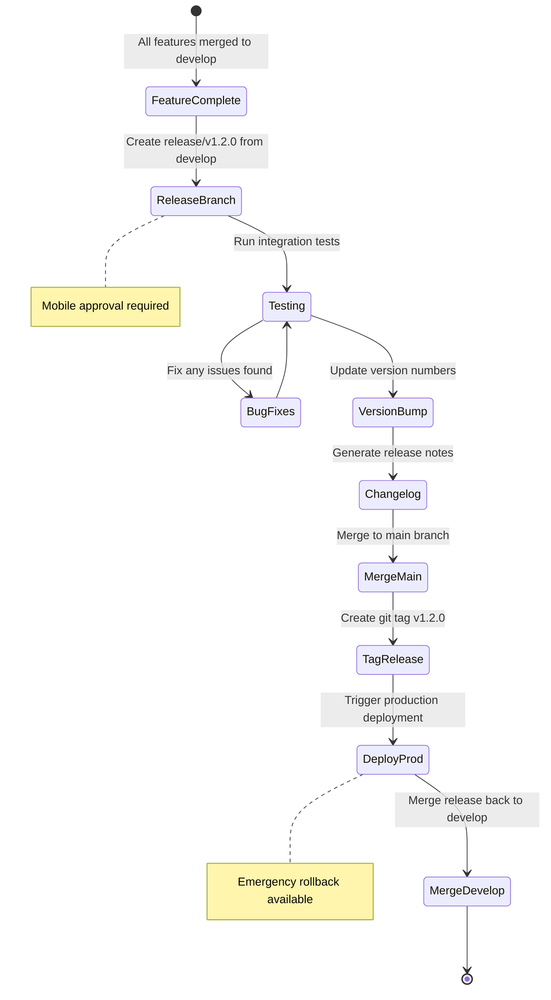

## Mobile KiloCode Integration Architecture

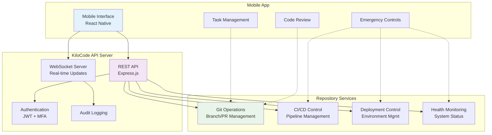

## Emergency Response Workflow

```mermaid
flowchart TD
    A[Incident Detected] --> B{Classification}
    B -->|Level 1 Critical| C[Immediate Alert]
    B -->|Level 2 High| D[Urgent Alert]
    B -->|Level 3 Medium| E[Scheduled Response]

    C --> F[Mobile Emergency Dashboard]
    D --> F
    E --> G[Standard Process]

    F --> H{Assessment}
    H -->|System Down| I[Execute Emergency Halt]
    H -->|Security Breach| J[Isolate Systems]
    H -->|Data Corruption| K[Activate Backup]

    I --> L[Containment Actions]
    J --> L
    K --> L

    L --> M[Recovery Procedures]
    M --> N[Communication Updates]
    N --> O[Post-mortem Analysis]
    O --> P[Documentation & Prevention]

    G --> Q[Normal Incident Response]
    Q --> R[Resolution]
    R --> S[Close Incident]

    style C fill:#ffebee
    style I fill:#ffebee
    style F fill:#fff3e0
```

## Pull Request Review Process

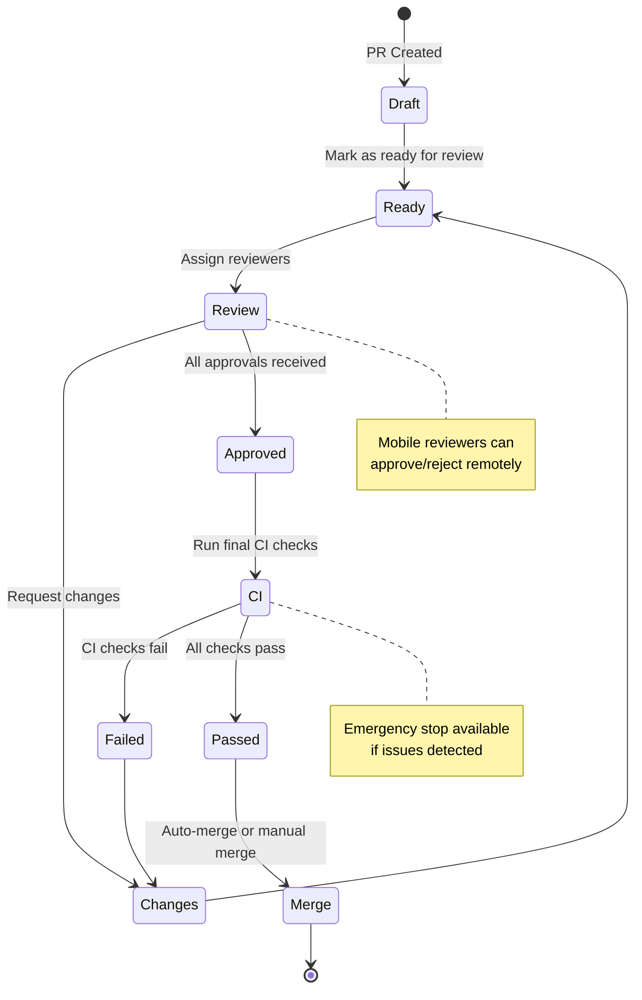

## Mobile Task Management Flow

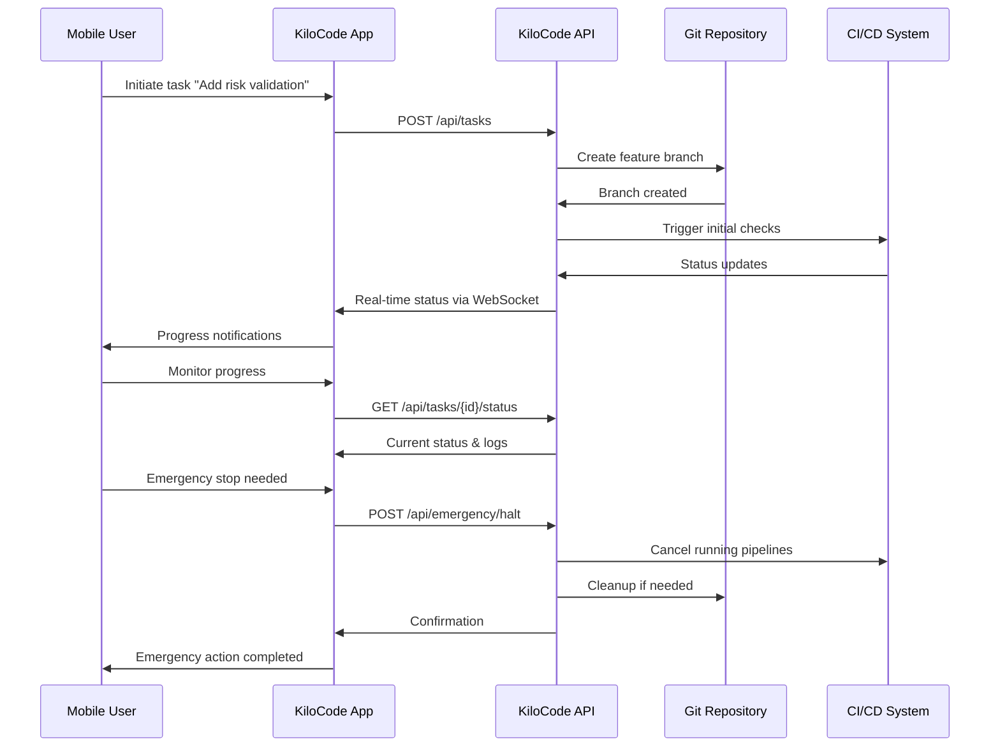

## Quality Gate Pipeline

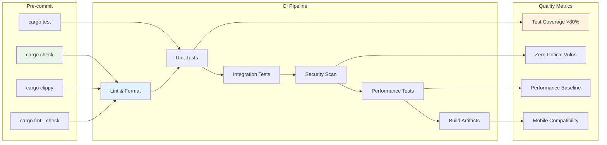

## Mobile Emergency Dashboard

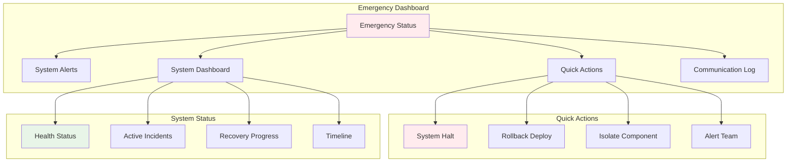

## Commit Message Validation

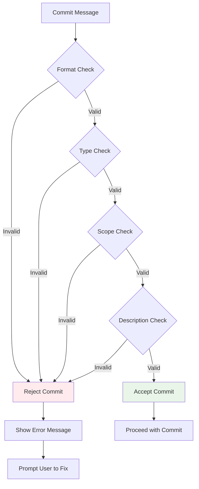

## Mobile Authentication Flow

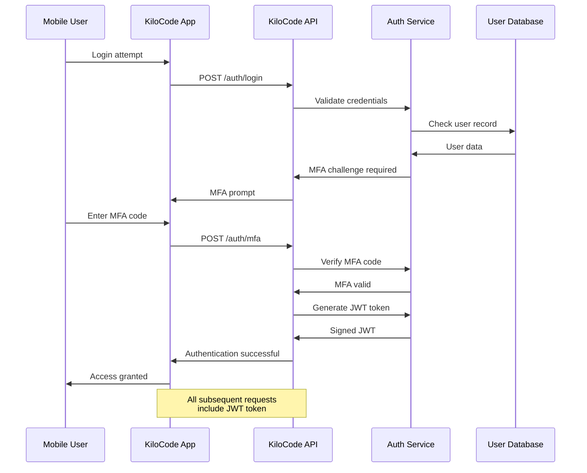

---

## Legend

### Branch Colors
- 🔵 **Main**: Production ready
- 🟣 **Develop**: Integration branch
- 🟢 **Feature**: Development work
- 🟠 **Release**: Stabilization
- 🔴 **Hotfix**: Emergency fixes

### Status Indicators
- ✅ **Pass**: Successful operation
- ❌ **Fail**: Failed operation
- ⏳ **Pending**: In progress
- 🚨 **Alert**: Requires attention

### Mobile Capabilities
- 📱 **Full Access**: Complete mobile functionality
- 📊 **Read-only**: Status monitoring only
- 🚨 **Emergency**: Emergency controls only
- 🔒 **Restricted**: Limited access

These diagrams provide visual guidance for all git workflow processes and mobile integration points. They serve as quick references for team members and mobile users.