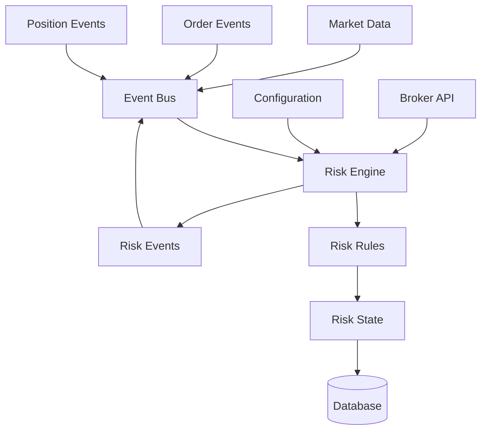

# Phase 2 Risk Management Implementation Plan

**Date:** December 17, 2025
**Status:** Ready for Implementation
**Version:** 1.0

---

## Executive Summary

Phase 2 builds on the excellent Phase 1 foundation to implement comprehensive risk management capabilities. The existing event-driven architecture, type-safe configuration, and database schema provide an ideal foundation for risk management implementation.

**Key Advantages from Phase 1:**
- ✅ Event-driven architecture with zero-copy risk events already defined
- ✅ Type-safe configuration with comprehensive risk settings
- ✅ Database schema with `daily_risk_metrics`, `pattern_stats`, and `audit_log` tables
- ✅ Functional programming principles and async-first design
- ✅ Comprehensive error handling and broker abstraction

**Phase 2 Success Criteria:**
- All risk rules implemented and tested
- Seamless integration with existing Phase 1 components
- Event-driven risk monitoring operational
- Configuration-driven risk policies
- Ready for Phase 3 (Pattern Recognition)

---

## 1. Risk Management Architecture

### Core Components

#### Risk Engine (`src/risk/engine.rs`)
Central component that orchestrates risk evaluation and enforcement.

**Responsibilities:**
- Coordinate risk rule evaluation
- Maintain risk state (daily P&L, positions, trade counts)
- Publish risk events to event bus
- Handle risk violation responses (halt trading, liquidate positions)

**Design Principles:**
- Async-first with Tokio
- Immutable state updates
- Event-driven responses
- Zero-copy where possible

#### Risk Rules (`src/risk/rules/`)
Composable, configurable risk policies implemented as separate modules.

**Rule Categories:**
- `daily_loss.rs` - Daily P&L limits and tracking
- `position_size.rs` - Position size validation
- `pdt.rs` - Pattern Day Trading rules
- `pattern_limits.rs` - Pattern-specific trading limits
- `account_safeguards.rs` - Account balance protection

#### Risk State (`src/risk/state.rs`)
Persistent risk tracking with database integration.

**Tracked Metrics:**
- Daily realized/unrealized P&L
- Position sizes and portfolio allocation
- Day trade counts (PDT compliance)
- Pattern performance statistics
- Account balance and equity

#### Risk Events Integration
Leverages existing event bus infrastructure:

```rust
// Already defined in src/events/types.rs
MarketEvent::RiskViolation { violation: RiskViolation }
MarketEvent::RiskWarning { warning: Message }
```

### Architecture Diagram



---

## 2. Specific Risk Rules Implementation

### 2.1 Daily Loss Limits (`src/risk/rules/daily_loss.rs`)

**Requirements:**
- Track realized + unrealized P&L throughout trading day
- Enforce dollar and percentage limits
- Halt trading when limits exceeded
- Reset tracking at market open

**Implementation:**
- Subscribe to `PositionUpdated` and `OrderFilled` events
- Query account balance via broker API
- Calculate total P&L: `realized_pl + unrealized_pl`
- Compare against `max_daily_loss_dollars` and `max_daily_loss_percent`
- Publish `RiskViolation` when limits breached

**Configuration (already in `config/default.toml`):**
```toml
[risk]
max_daily_loss_dollars = 500.00
max_daily_loss_percent = 2.00
halt_trading_on_limit = true
```

### 2.2 Position Size Validation (`src/risk/rules/position_size.rs`)

**Requirements:**
- Maximum position size in dollars
- Maximum position size as portfolio percentage
- Maximum concurrent positions
- Real-time validation before order execution

**Implementation:**
- Subscribe to `OrderPlaced` events for pre-trade validation
- Query current positions via broker API
- Calculate portfolio value and position allocations
- Validate against `max_position_size_dollars` and `max_position_size_percent`
- Reject orders that exceed limits

**Configuration:**
```toml
[risk]
max_position_size_dollars = 5000.00
max_position_size_percent = 10.00
max_concurrent_positions = 5
```

### 2.3 PDT Rule Enforcement (`src/risk/rules/pdt.rs`)

**Requirements:**
- Track day trades (open and close same security in single trading day)
- Enforce 3-day trade limit under PDT rules
- Require $25,000 minimum equity for PDT accounts
- Prevent additional day trades when limit reached

**Implementation:**
- Monitor `OrderFilled` events to detect day trades
- Track day trade count in `daily_risk_metrics` table
- Query account equity via broker API
- Block orders when `day_trades_count >= max_day_trades_under_pdt`
- Special handling for PDT accounts vs. cash accounts

**Configuration:**
```toml
[risk]
enforce_pdt_rule = true
pdt_min_equity = 25000.00
max_day_trades_under_pdt = 3
```

### 2.4 Pattern-Specific Trading Limits (`src/risk/rules/pattern_limits.rs`)

**Requirements:**
- Maximum trades per pattern per day
- Disable patterns after consecutive losses
- Require minimum win rate for automated trading
- Minimum sample size for pattern evaluation

**Implementation:**
- Track pattern performance in `pattern_stats` table
- Update statistics on `OrderFilled` events with `pattern_name`
- Validate trade counts against `max_trades_per_pattern_per_day`
- Disable patterns when `consecutive_losses >= stop_pattern_after_consecutive_losses`
- Require `win_rate >= required_win_rate_for_auto` for automation

**Configuration:**
```toml
[risk]
max_trades_per_pattern_per_day = 5
stop_pattern_after_consecutive_losses = 3
required_win_rate_for_auto = 60.00
min_pattern_sample_size = 20
```

### 2.5 Account Safeguards (`src/risk/rules/account_safeguards.rs`)

**Requirements:**
- Minimum account balance enforcement
- Emergency liquidation thresholds
- Insufficient funds detection
- Account protection overrides

**Implementation:**
- Continuous account balance monitoring
- Emergency liquidation when balance <= `emergency_liquidate_threshold`
- Block orders when balance < `min_account_balance`
- Integration with broker API for real-time balance queries

**Configuration:**
```toml
[risk]
min_account_balance = 1000.00
emergency_liquidate_threshold = 500.00
```

---

## 3. Integration Points

### 3.1 Event Bus Integration

**Subscribed Events:**
- `MarketEvent::OrderPlaced` - Pre-trade risk validation
- `MarketEvent::OrderFilled` - Update risk metrics, detect violations
- `MarketEvent::PositionOpened` - Track position sizes
- `MarketEvent::PositionUpdated` - Monitor P&L changes
- `MarketEvent::PositionClosed` - Update realized P&L

**Published Events:**
- `MarketEvent::RiskViolation` - Rule violations requiring action
- `MarketEvent::RiskWarning` - Non-blocking risk alerts
- `MarketEvent::TradingHalted` - Emergency trading stops
- `MarketEvent::TradingResumed` - Normal trading restored

### 3.2 Broker Integration

**Required Broker Methods (extend existing traits):**
```rust
#[async_trait]
pub trait RiskDataProvider {
    async fn get_account_balance(&self) -> Result<Decimal, BrokerError>;
    async fn get_account_equity(&self) -> Result<Decimal, BrokerError>;
    async fn get_positions(&self) -> Result<Vec<Position>, BrokerError>;
    async fn get_daily_pl(&self) -> Result<Decimal, BrokerError>;
}
```

**Integration Points:**
- Real-time balance queries for risk validation
- Position data for portfolio allocation calculations
- Account equity for PDT compliance checking
- Daily P&L for loss limit enforcement

### 3.3 Data Pipeline Integration

**Database Tables Utilized:**
- `daily_risk_metrics` - Daily P&L and trade tracking
- `pattern_stats` - Pattern performance and enable/disable status
- `audit_log` - Risk event logging and compliance trail
- `positions` - Current position data
- `trades` - Trade history for day trade detection

**Storage Integration:**
- Async database writes for risk state persistence
- Batch updates for performance
- Transactional consistency for risk state changes

### 3.4 Configuration Integration

**Extended RiskConfig Structure:**
```rust
#[derive(Debug, Clone, Serialize, Deserialize)]
pub struct RiskConfig {
    // Daily loss limits
    pub max_daily_loss_dollars: f64,
    pub max_daily_loss_percent: f64,
    pub halt_trading_on_limit: bool,

    // Position sizing
    pub max_position_size_dollars: f64,
    pub max_position_size_percent: f64,
    pub max_concurrent_positions: u32,

    // PDT protection
    pub enforce_pdt_rule: bool,
    pub pdt_min_equity: f64,
    pub max_day_trades_under_pdt: u32,

    // Pattern-specific rules
    pub max_trades_per_pattern_per_day: u32,
    pub stop_pattern_after_consecutive_losses: u32,
    pub required_win_rate_for_auto: f64,
    pub min_pattern_sample_size: u32,

    // Account safeguards
    pub min_account_balance: f64,
    pub emergency_liquidate_threshold: f64,
}
```

---

## 4. Risk Data Model

### 4.1 Risk Metrics

**Daily Risk Metrics:**
```rust
pub struct DailyRiskMetrics {
    pub account_id: i64,
    pub trading_date: NaiveDate,
    pub starting_balance: Decimal,
    pub current_balance: Decimal,
    pub realized_pl: Decimal,
    pub unrealized_pl: Decimal,
    pub total_pl: Decimal,
    pub day_trades_count: u32,
    pub trades_count: u32,
    pub largest_loss: Decimal,
    pub is_trading_halted: bool,
    pub halt_reason: Option<String>,
}
```

**Pattern Performance:**
```rust
pub struct PatternStats {
    pub pattern_name: String,
    pub total_signals: u32,
    pub total_trades: u32,
    pub winning_trades: u32,
    pub losing_trades: u32,
    pub total_profit: Decimal,
    pub win_rate: f64,
    pub avg_profit_per_trade: Decimal,
    pub consecutive_losses: u32,
    pub is_enabled: bool,
}
```

### 4.2 Risk Limits

**Configurable Thresholds:**
- Dollar amounts with Decimal precision
- Percentage limits (0.0-100.0)
- Count limits (positions, trades, consecutive losses)
- Boolean enable/disable flags

**Dynamic Limits:**
- Portfolio-based percentage calculations
- Account equity-based PDT thresholds
- Pattern performance-based enable/disable

### 4.3 Risk Violations

**Violation Types (already defined):**
```rust
pub enum RiskViolationType {
    DailyLossLimit,
    PositionSizeLimit,
    PdtLimit,
    PatternDisabled,
    InsufficientFunds,
    Other,
}
```

**Structured Violations:**
```rust
pub struct RiskViolation {
    pub violation_type: RiskViolationType,
    pub message: Message,
    pub timestamp: DateTime<Utc>,
    pub severity: ViolationSeverity,
    pub suggested_action: Option<String>,
}
```

### 4.4 Risk History

**Audit Trail:**
- All risk evaluations logged to `audit_log` table
- Risk violations with full context
- Configuration changes tracked
- Performance metrics history

**Reporting:**
- Daily risk summaries
- Pattern performance reports
- Violation incident reports
- Compliance documentation

---

## 5. Implementation Phases

### Phase 2A: Core Risk Engine and Daily Loss Tracking (Week 1-2)

**Week 1: Foundation**
- [ ] Design risk module structure
- [ ] Implement risk types and newtypes
- [ ] Create basic risk engine skeleton
- [ ] Set up event bus subscriptions

**Week 2: Daily Loss Tracking**
- [ ] Implement daily P&L calculation
- [ ] Add loss limit enforcement
- [ ] Integrate with database persistence
- [ ] Add comprehensive unit tests

### Phase 2B: Position Sizing and PDT Rules (Week 3-4)

**Week 3: Position Sizing**
- [ ] Implement position size validation
- [ ] Add portfolio allocation checks
- [ ] Integrate with order placement flow
- [ ] Add position size tests

**Week 4: PDT Rules**
- [ ] Implement day trade detection
- [ ] Add PDT limit enforcement
- [ ] Integrate account equity queries
- [ ] Add PDT compliance tests

### Phase 2C: Pattern-Specific Limits and Event Integration (Week 5-6)

**Week 5: Pattern Limits**
- [ ] Implement pattern performance tracking
- [ ] Add pattern-specific trade limits
- [ ] Integrate with pattern detection events
- [ ] Add pattern limit tests

**Week 6: Event Integration**
- [ ] Complete event bus integration
- [ ] Add risk monitoring dashboard hooks
- [ ] Implement risk alert system
- [ ] Add integration tests

### Phase 2D: Testing, Documentation, and Integration (Week 7-8)

**Week 7: Testing and Refinement**
- [ ] Comprehensive unit test coverage
- [ ] Property-based testing for edge cases
- [ ] Performance benchmarking
- [ ] Bug fixes and refinements

**Week 8: Documentation and Deployment**
- [ ] Complete API documentation
- [ ] Create usage examples
- [ ] Update deployment configuration
- [ ] Integration testing with Phase 1 components

---

## 6. Testing Strategy

### Unit Tests
- Individual risk rule validation
- Edge case handling (zero balances, extreme losses)
- Type safety verification
- Configuration parsing tests

### Integration Tests
- Risk engine with event bus
- Database persistence and retrieval
- Broker API integration
- End-to-end risk scenario testing

### Property-Based Testing
- Risk rule invariants (limits never exceeded)
- Edge cases (market crashes, high volatility)
- Concurrent operation safety

### End-to-End Tests
- Complete trading workflows with risk management
- Multi-day trading scenarios
- PDT rule enforcement across trading sessions
- Emergency liquidation procedures

---

## 7. Configuration and Deployment

### Configuration Updates
- Extend `RiskConfig` struct to match TOML settings
- Add validation for configuration values
- Support environment-based overrides
- Configuration hot-reloading capability

### Docker Integration
- Risk service containerization
- Multi-service orchestration with docker-compose
- Health checks for risk monitoring
- Resource limits and scaling configuration

### Monitoring and Alerting
- Risk violation alerting system
- Performance metrics collection
- Dashboard integration points
- Log aggregation and analysis

---

## 8. Deliverables Checklist

### Module Structure
- [ ] `src/risk/mod.rs` - Main module exports
- [ ] `src/risk/engine.rs` - Core risk evaluation engine
- [ ] `src/risk/state.rs` - Risk state management
- [ ] `src/risk/rules/` - Individual risk rule implementations
- [ ] `src/risk/types.rs` - Risk-specific types and newtypes

### Risk Rules Implementation
- [ ] Daily loss limits and tracking
- [ ] Position size validation
- [ ] PDT rule enforcement
- [ ] Pattern-specific limits
- [ ] Account safeguards

### Integration Components
- [ ] Event bus subscriptions and publications
- [ ] Broker API extensions for risk data
- [ ] Database integration for risk persistence
- [ ] Configuration system updates

### Testing and Documentation
- [ ] Comprehensive unit tests (>80% coverage)
- [ ] Integration tests with Phase 1 components
- [ ] API documentation and examples
- [ ] Performance benchmarks

---

## 9. Success Criteria

### Functional Requirements
- [ ] All risk rules implemented and operational
- [ ] Real-time risk monitoring via event bus
- [ ] Configuration-driven risk policies
- [ ] Database persistence of risk state
- [ ] Comprehensive error handling

### Integration Requirements
- [ ] Seamless integration with Phase 1 architecture
- [ ] Event-driven risk monitoring working
- [ ] Broker API extensions functional
- [ ] Configuration system updated

### Quality Requirements
- [ ] Zero compiler warnings
- [ ] Comprehensive test coverage
- [ ] Performance benchmarks established
- [ ] Documentation complete

### Safety Requirements
- [ ] Risk violations prevent unsafe trading
- [ ] Account protection mechanisms active
- [ ] Emergency procedures functional
- [ ] Audit trail maintained

---

## 10. Technical Constraints

### Architecture Constraints
- Must integrate seamlessly with Phase 1 event-driven design
- Maintain functional programming principles
- Async-first implementation throughout
- Zero-copy design where possible

### Performance Constraints
- Risk evaluation must be sub-millisecond
- Database operations non-blocking
- Event processing must not bottleneck trading
- Memory usage bounded and predictable

### Safety Constraints
- Risk rules must never allow unsafe trading
- Configuration errors must fail safely
- Database corruption must not compromise safety
- Network failures must not bypass risk checks

---

## 11. Implementation Timeline

### Week 1-2: Core Infrastructure
- Risk types and engine foundation
- Daily loss tracking implementation
- Basic event integration

### Week 3-4: Advanced Rules
- Position sizing and PDT rules
- Pattern-specific limits
- Enhanced broker integration

### Week 5-6: Integration and Monitoring
- Complete event bus integration
- Risk monitoring and alerting
- Performance optimization

### Week 7-8: Testing and Deployment
- Comprehensive testing
- Documentation and examples
- Production deployment preparation

---

## 12. Risk Assessment

### Technical Risks
- **Event Bus Performance**: Risk evaluation could bottleneck high-frequency events
  - *Mitigation*: Async processing, efficient data structures, benchmarking

- **Database Contention**: Risk state updates during peak trading
  - *Mitigation*: Connection pooling, batch updates, read replicas

- **Configuration Complexity**: Complex risk rule interactions
  - *Mitigation*: Comprehensive testing, clear documentation, validation

### Business Risks
- **False Positives**: Overly aggressive risk rules blocking valid trades
  - *Mitigation*: Configurable thresholds, warning vs. blocking modes

- **Integration Issues**: Conflicts with existing Phase 1 components
  - *Mitigation*: Incremental integration, extensive testing

- **Performance Impact**: Risk checks slowing down trading execution
  - *Mitigation*: Performance benchmarks, optimization, async processing

---

## 13. Conclusion

Phase 2 Risk Management builds directly on Phase 1's solid foundation, leveraging existing event-driven architecture, type-safe configuration, and comprehensive database schema. The implementation will deliver enterprise-grade risk management capabilities while maintaining the project's commitment to functional programming, type safety, and performance.

**Ready for Implementation:** All architectural foundations are in place, configuration is prepared, and database schema supports risk tracking requirements.

**Next Steps:**
1. Begin implementation with risk types and basic engine
2. Implement daily loss tracking as first functional component
3. Progress through position sizing, PDT rules, and pattern limits
4. Complete with comprehensive testing and documentation

---

**Document Version:** 1.0
**Last Updated:** December 17, 2025
**Status:** Approved for Implementation