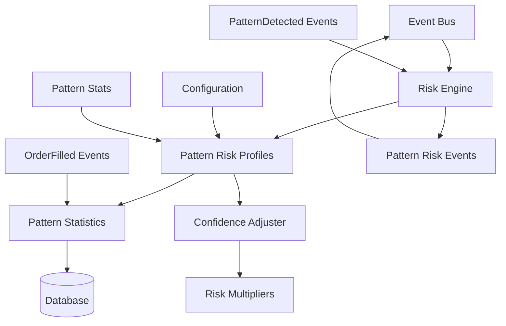

# Phase 2B Pattern-Specific Trading Limits Implementation Plan

**Date:** December 18, 2025
**Status:** Ready for Implementation
**Version:** 1.0

---

## Executive Summary

Phase 2B builds on the solid Phase 2A foundation to implement comprehensive pattern-specific risk management. The existing event-driven architecture, type-safe configuration, and database schema provide an ideal foundation for pattern-aware risk rules. This implementation will add different risk limits for different candlestick patterns (Hammer, Doji, Engulfing, etc.), confidence-based adjustments, and enhanced event subscriptions for real-time pattern risk monitoring.

**Key Advantages from Phase 2A:**
- ✅ Event-driven architecture with `PatternDetected` events already defined
- ✅ Type-safe configuration with comprehensive risk settings
- ✅ Database schema with `pattern_stats` table for performance tracking
- ✅ Functional programming principles and async-first design
- ✅ Comprehensive error handling and broker abstraction

**Phase 2B Success Criteria:**
- Pattern-specific risk rules implemented and tested
- Confidence-based risk adjustments operational
- Enhanced event subscriptions for pattern monitoring
- Integration with existing Phase 2A risk framework
- Ready for Phase 3 (Pattern Recognition) integration

---

## 1. Pattern Risk Architecture

### Core Components

#### Pattern Risk Profiles (`src/risk/pattern_limits.rs`)
Central component for pattern-specific risk evaluation and enforcement.

**Responsibilities:**
- Maintain configurable risk profiles per pattern type
- Apply confidence-based risk adjustments
- Track pattern performance statistics
- Enforce pattern-specific trade limits and position sizing
- Publish pattern-aware risk events

**Design Principles:**
- Async-first with Tokio
- Immutable pattern risk state updates
- Event-driven pattern risk monitoring
- Zero-copy pattern signal processing where possible

#### Pattern Statistics Tracker (`src/risk/pattern_stats.rs`)
Tracks and analyzes pattern performance for risk adjustments.

**Responsibilities:**
- Update pattern win/loss ratios on trade completion
- Calculate rolling performance windows
- Determine pattern enable/disable status
- Provide statistics for confidence-based risk multipliers

#### Confidence-Based Risk Adjuster (`src/risk/confidence_adjuster.rs`)
Dynamically adjusts risk limits based on pattern recognition confidence.

**Responsibilities:**
- Map confidence scores to risk multipliers
- Apply progressive risk reduction for low-confidence signals
- Maintain confidence thresholds per pattern type

### Architecture Diagram



---

## 2. Specific Pattern Risk Rules Implementation

### 2.1 Pattern Risk Profiles

**Hammer Pattern:**
- **Risk Profile:** Conservative position sizing (60% of base limits)
- **Confidence Threshold:** Minimum 0.75 for automated trading
- **Trade Limits:** 3 trades per day maximum
- **Position Size:** 70% of standard position size limits
- **Rationale:** Hammer patterns are reliable but require confirmation

**Doji Pattern:**
- **Risk Profile:** Very conservative (40% of base limits)
- **Confidence Threshold:** Minimum 0.80 for any trading
- **Trade Limits:** 2 trades per day maximum
- **Position Size:** 50% of standard position size limits
- **Rationale:** Doji indicates indecision, high uncertainty

**Engulfing Pattern:**
- **Risk Profile:** Moderate risk (80% of base limits)
- **Confidence Threshold:** Minimum 0.70 for automated trading
- **Trade Limits:** 4 trades per day maximum
- **Position Size:** 85% of standard position size limits
- **Rationale:** Strong reversal signal but needs volume confirmation

**Morning/Evening Star:**
- **Risk Profile:** Higher tolerance (90% of base limits)
- **Confidence Threshold:** Minimum 0.65 for automated trading
- **Trade Limits:** 5 trades per day maximum
- **Position Size:** 95% of standard position size limits
- **Rationale:** Proven multi-candle patterns with high reliability

**Custom Pattern Rules:**
- **Extensible Framework:** New patterns can be added via configuration
- **Default Profile:** Conservative settings until performance data available
- **Dynamic Adjustment:** Risk profiles evolve based on actual performance

### 2.2 Confidence-Based Adjustments

**Confidence Multipliers:**
```rust
pub struct ConfidenceMultiplier {
    pub confidence_range: Range<f64>,
    pub position_size_multiplier: f64,
    pub trade_limit_multiplier: f64,
    pub risk_limit_multiplier: f64,
}
```

**Example Multipliers:**
- **0.0-0.3:** 0.3x multiplier (very conservative)
- **0.3-0.5:** 0.5x multiplier (conservative)
- **0.5-0.7:** 0.8x multiplier (moderate)
- **0.7-0.9:** 1.0x multiplier (standard)
- **0.9-1.0:** 1.2x multiplier (aggressive for high-confidence)

**Progressive Risk Reduction:**
- Consecutive losses trigger automatic multiplier reduction
- Pattern disable after 3+ consecutive losses
- Recovery requires 3 winning trades to restore full limits

### 2.3 Pattern Statistics Tracking

**Rolling Performance Windows:**
- 30-day rolling statistics for win rate calculation
- 90-day rolling statistics for long-term performance
- Minimum sample size of 20 trades before enabling automation

**Performance Metrics:**
```rust
pub struct PatternPerformance {
    pub total_signals: u32,
    pub total_trades: u32,
    pub winning_trades: u32,
    pub losing_trades: u32,
    pub total_profit: Decimal,
    pub win_rate: f64,
    pub avg_profit_per_trade: Decimal,
    pub max_drawdown: Decimal,
    pub consecutive_losses: u32,
    pub is_enabled: bool,
}
```

**Real-time Updates:**
- Statistics updated on `OrderFilled` events with `pattern_name`
- Pattern enable/disable status recalculated daily
- Performance alerts when patterns underperform

---

## 3. Integration Points

### 3.1 Event Bus Integration

**Subscribed Events:**
- `MarketEvent::PatternDetected` - New pattern signals for risk evaluation
- `MarketEvent::OrderFilled` - Update pattern statistics and performance
- `MarketEvent::OrderPlaced` - Pre-trade pattern risk validation
- `MarketEvent::PositionUpdated` - Monitor pattern-based position sizes

**Published Events:**
- `MarketEvent::PatternRiskViolation` - Pattern-specific rule violations
- `MarketEvent::PatternDisabled` - Pattern disabled due to poor performance
- `MarketEvent::PatternReEnabled` - Pattern restored after recovery
- `MarketEvent::ConfidenceAdjustment` - Risk limit adjustments based on confidence

### 3.2 Broker Integration

**Extended Broker Methods:**
```rust
#[async_trait]
pub trait PatternRiskDataProvider {
    async fn get_pattern_positions(&self, pattern_name: &str) -> Result<Vec<Position>, BrokerError>;
    async fn get_pattern_trades_today(&self, pattern_name: &str) -> Result<u32, BrokerError>;
}
```

**Integration Points:**
- Pattern-specific position tracking
- Daily trade counting per pattern
- Account equity queries for PDT compliance with patterns

### 3.3 Database Integration

**Enhanced Pattern Stats Table:**
```sql
-- Existing pattern_stats table already supports:
-- total_signals, total_trades, winning_trades, losing_trades
-- total_profit, win_rate, avg_profit_per_trade, consecutive_losses
-- is_enabled, max_trades_per_day, stop_after_consecutive_losses
-- required_win_rate, min_sample_size

-- Add confidence-based tracking
ALTER TABLE pattern_stats ADD COLUMN
    avg_confidence REAL DEFAULT 0.0;

ALTER TABLE pattern_stats ADD COLUMN
    confidence_weighted_win_rate REAL DEFAULT 0.0;

ALTER TABLE pattern_stats ADD COLUMN
    last_confidence_adjustment TIMESTAMP;
```

**Pattern Risk Tracking Table:**
```sql
CREATE TABLE IF NOT EXISTS pattern_risk_tracking (
    id INTEGER PRIMARY KEY AUTOINCREMENT,
    account_id INTEGER NOT NULL,
    pattern_name TEXT NOT NULL,
    confidence REAL NOT NULL,
    position_size_limit REAL,
    trade_limit_today INTEGER,
    risk_multiplier REAL,
    is_violation BOOLEAN DEFAULT FALSE,
    violation_reason TEXT,
    created_at TIMESTAMP DEFAULT CURRENT_TIMESTAMP,
    FOREIGN KEY (account_id) REFERENCES accounts(id),
    UNIQUE(account_id, pattern_name)
);
```

### 3.4 Configuration Integration

**Extended RiskConfig Structure:**
```rust
#[derive(Debug, Clone, Serialize, Deserialize)]
pub struct RiskConfig {
    // ... existing fields ...

    // Pattern-specific risk profiles
    pub pattern_risk_profiles: HashMap<String, PatternRiskProfile>,

    // Confidence-based adjustments
    pub confidence_multipliers: Vec<ConfidenceMultiplier>,

    // Pattern performance thresholds
    pub pattern_performance_thresholds: PatternPerformanceThresholds,
}

#[derive(Debug, Clone, Serialize, Deserialize)]
pub struct PatternRiskProfile {
    pub max_trades_per_day: u32,
    pub max_position_size_multiplier: f64,
    pub min_confidence_threshold: f64,
    pub risk_multiplier: f64,
    pub stop_after_consecutive_losses: u32,
}
```

**Configuration Example:**
```toml
[risk.pattern_profiles.hammer]
max_trades_per_day = 3
max_position_size_multiplier = 0.7
min_confidence_threshold = 0.75
risk_multiplier = 0.6
stop_after_consecutive_losses = 3

[risk.pattern_profiles.doji]
max_trades_per_day = 2
max_position_size_multiplier = 0.5
min_confidence_threshold = 0.80
risk_multiplier = 0.4
stop_after_consecutive_losses = 2

[risk.confidence_multipliers]
ranges = [
    { min = 0.0, max = 0.3, position_multiplier = 0.3, trade_multiplier = 0.5 },
    { min = 0.3, max = 0.5, position_multiplier = 0.5, trade_multiplier = 0.7 },
    { min = 0.5, max = 0.7, position_multiplier = 0.8, trade_multiplier = 0.9 },
    { min = 0.7, max = 0.9, position_multiplier = 1.0, trade_multiplier = 1.0 },
    { min = 0.9, max = 1.0, position_multiplier = 1.2, trade_multiplier = 1.1 }
]
```

---

## 4. Pattern Risk Data Model

### 4.1 Pattern Risk Metrics

**Pattern Risk State:**
```rust
pub struct PatternRiskState {
    pub pattern_name: String,
    pub daily_trade_count: u32,
    pub consecutive_losses: u32,
    pub is_enabled: bool,
    pub current_risk_multiplier: f64,
    pub last_updated: DateTime<Utc>,
}
```

**Confidence-Adjusted Limits:**
```rust
pub struct ConfidenceAdjustedLimits {
    pub base_limits: RiskLimits,
    pub confidence_multiplier: f64,
    pub adjusted_position_size: DollarAmount,
    pub adjusted_trade_limit: Count,
    pub adjusted_risk_limit: DollarAmount,
}
```

### 4.2 Pattern Performance Thresholds

**Performance Windows:**
- **Short-term:** 7-day rolling window for recent performance
- **Medium-term:** 30-day rolling window for trend analysis
- **Long-term:** 90-day rolling window for overall reliability

**Threshold Definitions:**
```rust
pub struct PatternPerformanceThresholds {
    pub min_win_rate_short: Percentage,
    pub min_win_rate_medium: Percentage,
    pub min_win_rate_long: Percentage,
    pub max_consecutive_losses: Count,
    pub min_sample_size: Count,
    pub auto_disable_threshold: Percentage,
}
```

### 4.3 Pattern Risk Violations

**Pattern-Specific Violation Types:**
```rust
pub enum PatternRiskViolationType {
    PatternDisabled,
    ConfidenceTooLow,
    DailyTradeLimitExceeded,
    PositionSizeExceeded,
    ConsecutiveLossesExceeded,
    PerformanceThresholdBreached,
}
```

**Structured Pattern Violations:**
```rust
pub struct PatternRiskViolation {
    pub violation_type: PatternRiskViolationType,
    pub pattern_name: String,
    pub confidence: Option<f64>,
    pub message: Message,
    pub timestamp: DateTime<Utc>,
    pub severity: ViolationSeverity,
    pub suggested_action: Option<String>,
}
```

### 4.4 Pattern Risk History

**Audit Trail Extensions:**
- Pattern risk evaluations logged to `audit_log` table
- Confidence adjustments tracked with timestamps
- Pattern enable/disable events recorded
- Performance-based rule changes documented

**Reporting:**
- Daily pattern risk summaries
- Confidence distribution analysis
- Pattern performance vs. risk adjustment correlation
- Risk violation incident reports

---

## 5. Implementation Phases

### Phase 2B-1: Core Pattern Risk Profiles and Basic Rules (Week 1)

**Week 1 Objectives:**
- [ ] Design pattern risk module structure
- [ ] Implement pattern risk types and newtypes
- [ ] Create basic pattern risk profiles
- [ ] Set up pattern event subscriptions
- [ ] Add pattern risk configuration parsing

**Deliverables:**
- `src/risk/pattern_limits.rs` - Core pattern risk evaluation
- `src/risk/pattern_stats.rs` - Pattern performance tracking
- Extended `RiskConfig` with pattern profiles
- Basic pattern risk rule integration

### Phase 2B-2: Confidence-Based Adjustments and Statistics Tracking (Week 2)

**Week 2 Objectives:**
- [ ] Implement confidence multiplier system
- [ ] Add pattern statistics updates on trade completion
- [ ] Create confidence-based risk adjustments
- [ ] Integrate pattern performance thresholds
- [ ] Add comprehensive unit tests

**Deliverables:**
- `src/risk/confidence_adjuster.rs` - Confidence-based adjustments
- Enhanced pattern statistics tracking
- Confidence multiplier configuration
- Pattern performance threshold validation

### Phase 2B-3: Enhanced Event Subscriptions and Phase 3 Integration (Week 3)

**Week 3 Objectives:**
- [ ] Complete event bus integration for patterns
- [ ] Add pattern risk monitoring and alerting
- [ ] Implement pattern enable/disable logic
- [ ] Create pattern risk dashboard hooks
- [ ] Add integration tests with mock pattern events

**Deliverables:**
- Full event subscription system for patterns
- Pattern risk violation publishing
- Pattern performance monitoring
- Integration tests with Phase 2A components

### Phase 2B-4: Testing, Documentation, and Final Integration (Week 4)

**Week 4 Objectives:**
- [ ] Comprehensive unit test coverage (>80%)
- [ ] Integration tests with real pattern events
- [ ] Performance benchmarking for pattern risk evaluation
- [ ] Complete API documentation and examples
- [ ] Bug fixes and refinements

**Deliverables:**
- Full test suite for pattern risk components
- API documentation and usage examples
- Performance benchmarks established
- Ready for Phase 3 integration

---

## 6. Testing Strategy

### Unit Tests
- Individual pattern risk rule validation
- Confidence multiplier calculations
- Pattern performance threshold checking
- Edge cases (zero confidence, extreme loss streaks)
- Type safety verification for pattern risk types

### Integration Tests
- Pattern risk engine with event bus
- Database persistence and retrieval for pattern stats
- Broker API integration for pattern position queries
- End-to-end pattern risk scenario testing

### Property-Based Testing
- Pattern risk rule invariants (limits never exceeded)
- Confidence adjustment boundaries
- Concurrent pattern signal processing safety
- Pattern enable/disable state transitions

### End-to-End Tests
- Complete pattern trading workflows with risk management
- Multi-pattern trading scenarios
- Confidence-based risk adjustment across trading sessions
- Pattern performance degradation and recovery procedures

---

## 7. Configuration and Deployment

### Configuration Updates
- Extend `RiskConfig` struct to match TOML pattern settings
- Add validation for pattern risk profile values
- Support environment-based pattern configuration overrides
- Pattern risk hot-reloading capability

### Database Schema Updates
- Add confidence tracking columns to `pattern_stats`
- Create `pattern_risk_tracking` table for real-time monitoring
- Add indexes for pattern performance queries
- Migration scripts for existing deployments

### Docker Integration
- Pattern risk service containerization
- Multi-service orchestration with pattern event routing
- Health checks for pattern risk monitoring
- Resource limits and scaling for pattern processing

### Monitoring and Alerting
- Pattern risk violation alerting system
- Pattern performance metrics collection
- Confidence distribution monitoring
- Pattern enable/disable status alerts

---

## 8. Deliverables Checklist

### Module Structure
- [ ] `src/risk/pattern_limits.rs` - Pattern-specific risk evaluation
- [ ] `src/risk/pattern_stats.rs` - Pattern performance tracking
- [ ] `src/risk/confidence_adjuster.rs` - Confidence-based adjustments
- [ ] Extended `src/risk/types.rs` - Pattern risk types
- [ ] Updated `src/risk/mod.rs` - Module exports

### Pattern Risk Rules Implementation
- [ ] Pattern risk profiles for Hammer, Doji, Engulfing, Star patterns
- [ ] Confidence-based risk multipliers
- [ ] Pattern-specific trade limits and position sizing
- [ ] Pattern enable/disable based on performance
- [ ] Progressive risk reduction for underperforming patterns

### Integration Components
- [ ] Event bus subscriptions for pattern events
- [ ] Broker API extensions for pattern data
- [ ] Database integration for pattern risk persistence
- [ ] Configuration system updates for pattern profiles

### Testing and Documentation
- [ ] Comprehensive unit tests for pattern risk components
- [ ] Integration tests with Phase 2A risk framework
- [ ] API documentation and usage examples
- [ ] Performance benchmarks for pattern risk evaluation

---

## 9. Success Criteria

### Functional Requirements
- [ ] Pattern-specific risk rules implemented and operational
- [ ] Confidence-based risk adjustments working correctly
- [ ] Pattern performance tracking and statistics accurate
- [ ] Event-driven pattern risk monitoring functional
- [ ] Configuration-driven pattern risk policies

### Integration Requirements
- [ ] Seamless integration with existing Phase 2A components
- [ ] Pattern event consumption from future Phase 3
- [ ] Database persistence of pattern risk state
- [ ] Broker API extensions for pattern queries functional

### Quality Requirements
- [ ] Zero compiler warnings in pattern risk modules
- [ ] Comprehensive test coverage for pattern components
- [ ] Performance benchmarks established and met
- [ ] Documentation complete and accurate

### Safety Requirements
- [ ] Pattern risk violations prevent unsafe trading
- [ ] Confidence thresholds prevent low-quality signals
- [ ] Pattern disable logic protects against losses
- [ ] Audit trail maintained for pattern decisions

---

## 10. Technical Constraints

### Architecture Constraints
- Must integrate seamlessly with Phase 2A risk management
- Maintain functional programming principles
- Async-first design throughout pattern components
- Zero-copy event handling for pattern signals
- Type safety for all pattern risk operations

### Performance Constraints
- Pattern risk evaluation must be sub-millisecond
- Confidence calculations non-blocking
- Pattern statistics updates efficient
- Event processing must not bottleneck pattern detection

### Safety Constraints
- Pattern risk rules must never allow unsafe trading
- Confidence adjustments must be conservative by default
- Pattern performance data must be tamper-proof
- Network failures must not bypass pattern risk checks

---

## 11. Implementation Timeline

### Week 1: Core Pattern Risk Infrastructure
- Pattern risk types and basic profiles
- Pattern event subscription setup
- Configuration parsing for pattern settings

### Week 2: Confidence and Statistics
- Confidence-based adjustment system
- Pattern statistics tracking implementation
- Performance threshold validation

### Week 3: Event Integration and Monitoring
- Complete event bus integration
- Pattern risk monitoring and alerting
- Pattern enable/disable logic

### Week 4: Testing and Documentation
- Comprehensive testing suite
- API documentation and examples
- Performance optimization and final integration

---

## 12. Risk Assessment

### Technical Risks
- **Pattern Signal Volume:** High-frequency pattern detection could overwhelm risk evaluation
  - *Mitigation:* Async processing, efficient data structures, rate limiting

- **Database Contention:** Pattern statistics updates during peak trading
  - *Mitigation:* Batch updates, read replicas, optimized queries

- **Confidence Calculation Complexity:** Complex confidence-to-risk mapping
  - *Mitigation:* Pre-computed multipliers, comprehensive testing, clear documentation

### Business Risks
- **Over-conservative Rules:** Pattern risk rules blocking valid trading opportunities
  - *Mitigation:* Configurable thresholds, warning modes, performance monitoring

- **Pattern Performance Variability:** Different patterns perform differently over time
  - *Mitigation:* Rolling performance windows, adaptive thresholds, manual overrides

- **Integration Delays:** Phase 3 pattern recognition integration challenges
  - *Mitigation:* Mock pattern events for testing, clear interfaces, incremental integration

---

## 13. Conclusion

Phase 2B Pattern-Specific Trading Limits builds directly on Phase 2A's solid foundation, leveraging existing event-driven architecture, type-safe configuration, and comprehensive database schema. The implementation will deliver enterprise-grade pattern-aware risk management while maintaining the project's commitment to functional programming, type safety, and performance.

**Ready for Implementation:** All architectural foundations are in place, configuration is prepared, and database schema supports pattern risk tracking requirements.

**Next Steps:**
1. Begin implementation with pattern risk types and basic profiles
2. Implement confidence-based adjustments as core functionality
3. Add comprehensive pattern statistics tracking
4. Complete with enhanced event integration and testing

---

**Document Version:** 1.0
**Last Updated:** December 18, 2025
**Status:** Approved for Implementation