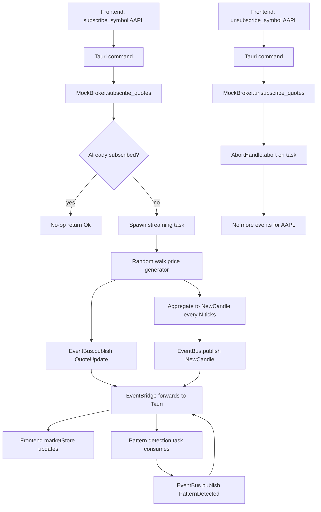

# Next Work Plan — Mock Market Data Streaming End-to-End (B-029 + B-033)

**Date:** 2026-06-19
**Author:** Architect (planning subtask)
**Status:** Proposed — awaiting Orchestrator approval
**Target Branch:** `feat/mock-market-streaming`
**Related Backlog IDs:** B-029 (Critical), B-033 (High)
**Optional Bundle Extension:** B-030 (chart), B-034 (risk auto-refresh) — out of scope here but enabled by this work

---

## 1. Project Context Snapshot

### What is done
- ✅ Phase 0–3 (setup, infrastructure, risk management 2A/2B, full pattern recognition 3A–3D)
- ✅ Phase 4A — Order Management (5 modules, 2,649 lines, completed 2026-01-25)
- ✅ Phase 4B — Position Tracking & P&L (1,659 lines production + 1,899 lines testing, 2026-01-25)
- ✅ Phase 4C scaffold — [`src/execution/`](src/execution:1) exists with [`engine.rs`](src/execution/engine.rs:1) (25 KB), [`strategy.rs`](src/execution/strategy.rs:1) (18 KB), [`rules.rs`](src/execution/rules.rs:1) (19 KB), [`mod.rs`](src/execution/mod.rs:1) (12 KB). Performance/auto-enable tracking present.
- ✅ Agent governance — [`CLAUDE.md`](CLAUDE.md:1), hooks, `verify_agent_work.sh`, module CLAUDE.md files, [`BACKLOG.md`](BACKLOG.md:1)
- ✅ Frontend critical-path fixes B-026, B-027, B-028, B-031, B-035, B-036 (test compilation), B-037 (21 test failures fixed)
- ✅ Test suite at 235/235 green on staging (most recent passing verification: 2026-05-25)

### What is in-progress / partially done
- 🔄 MCP servers under [`mcp-servers/`](mcp-servers:1) (com-01-alerting, dev-01-filesystem, dev-03-git, dev-05-database, mkt-01-realtime, mkt-02-historical). Most recent verification 2026-05-26 on branch `fix/review-mcp-security-hardening` failed 5 checks — likely in flight outside the backlog.
- 🔄 PDT edge cases — B-042 (holidays) and B-043 (DST) listed Medium; [`progress-tracking.md`](plans/progress-tracking.md:53) shows 60–70% completion.
- 🔄 Frontend dashboard — store/components exist but no live data flows because MockBroker is a no-op.

### What the backlog explicitly lists as "next"
The only **Critical** priority item still pending is:

- **B-029 — Wire MockBroker to emit synthetic market data events.**

The four **High** priority items downstream of it are blocked or visually empty without B-029:

- B-030 (candle chart), B-032 (PDT status panel), B-033 (subscribe_symbol streaming), B-034 (risk auto-refresh via events).

B-033 is so tightly coupled to B-029 (same MockBroker, same event flow, same `subscribe_quotes` plumbing) that they should be done as a single coherent slice.

---

## 2. Candidate Next-Work Items (Ranked)

| Rank | Candidate | Priority | Rationale | Recommendation |
|------|-----------|----------|-----------|----------------|
| **1** | **B-029 + B-033 bundle — Mock streaming end-to-end** | Critical + High | Only Critical pending; unblocks B-030/B-032/B-034; demonstrably restores end-to-end demo functionality; module-bounded; small enough to land in one feature branch. | ✅ **Selected** |
| 2 | B-042/B-043 — PDT holiday + DST edge cases | Medium | PDT is SEC-mandated (AGENTS.md rule 8) and rated *High Risk* in progress-tracking.md. Important but not blocking demoable functionality. | Defer to a follow-up; PDT is correct enough to ship per existing tests. |
| 3 | MCP security hardening (failing verification on `fix/review-mcp-security-hardening`) | Unknown | Not in BACKLOG.md; verification report shows 5 failures. Could be parallel work. | Triage separately — ask Orchestrator whether this is owned elsewhere. |
| 4 | B-047 — Replace trivial `assert!(true)` in [`src/risk/mod.rs`](src/risk/mod.rs:1) | Low | Quick win, governance audit gap, but cosmetic. | Bundle into a "test-quality cleanup" sweep later. |

**Why B-029 + B-033 wins:** It is the only **Critical** unfinished BACKLOG item, sits at the foundation layer ([`brokers/`](src/brokers:1)) so it respects the strict downward-flowing architecture, has no unmet dependencies, and immediately unblocks four downstream High-priority tasks. It is also high signal for stakeholders: today the Tauri app shows perpetual empty state because no events flow from MockBroker; after this work the dashboard ticks live.

---

## 3. Selected Plan: B-029 + B-033 — Mock Market Data Streaming End-to-End

### 3.1 Goal
Deliver an end-to-end mock market-data path so that subscribing to a symbol from the Tauri frontend causes [`MockBroker`](src/brokers/mock.rs:1) to publish synthetic `MarketEvent::QuoteUpdate` and `MarketEvent::NewCandle` events onto the [`EventBus`](src/events/bus.rs:1) at a configurable cadence, which the [`EventBridge`](daytrader/src-tauri/src/events.rs:1) forwards to the frontend, which in turn drives live updates in `MarketData`, `PatternList` (via existing pattern-detection task), and downstream consumers. Unsubscribing must stop the stream; resubscribing must be idempotent.

### 3.2 Scope & Non-Goals

**In scope**
- Extend `MockBroker` with a configurable synthetic-data generator (per-symbol Tokio task) that publishes Quote and Candle events to a shared `EventBus`.
- Make `MockBroker::subscribe_quotes` / `subscribe_candles` actually start/stop those tasks (idempotent for duplicate subscribes).
- Wire `daytrader/src-tauri/src/main.rs` to construct `MockBroker` with the `EventBus` it must publish to.
- Update [`commands/market_data.rs`](daytrader/src-tauri/src/commands/market_data.rs:68) `subscribe_symbol` (and add `unsubscribe_symbol`) so the frontend can start/stop streams.
- Tests: unit tests on MockBroker streaming, integration test that subscribing publishes ≥N events, frontend `npm run build` clean.
- Update [`BACKLOG.md`](BACKLOG.md:1) to move B-029 + B-033 to "Done" via the implementing subtask (Code mode), per agent rules.

**Out of scope**
- B-030 (chart) — separate task, but the events emitted here will feed it directly.
- B-034 (risk auto-refresh via events) — independent wiring change.
- Replacing MockBroker with Alpaca — real broker streaming is already implemented; this is purely the *Mock* path for demo/dev.
- Any changes to `execution/`, `orders/`, `positions/`, `risk/` modules.
- Production deployment / monitoring.

### 3.3 Affected Modules / Files

| Path | Change Type | Notes |
|------|-------------|-------|
| [`src/brokers/mock.rs`](src/brokers/mock.rs:1) | Modify | Add `EventBus` handle (optional), synthetic generator task spawner, subscription map (`DashMap<Symbol, JoinHandle>`), config knobs (interval, price model). |
| [`src/brokers/mod.rs`](src/brokers/mod.rs:1) | Modify only if re-exports change | Re-export new config type if added. |
| [`src/events/types.rs`](src/events/types.rs:1) | Read only — verify `QuoteUpdate` / `NewCandle` shapes | No schema changes expected. |
| [`daytrader/src-tauri/src/main.rs`](daytrader/src-tauri/src/main.rs:1) | Modify | Pass `EventBus` to `MockBroker` constructor; no longer rely on `MockBroker::default()`. |
| [`daytrader/src-tauri/src/commands/market_data.rs`](daytrader/src-tauri/src/commands/market_data.rs:1) | Modify | `subscribe_symbol` calls `broker.subscribe_quotes(vec![symbol]).await`; add new `unsubscribe_symbol` command; ensure idempotency for duplicate subscribes. |
| [`daytrader/src-tauri/src/state.rs`](daytrader/src-tauri/src/state.rs:1) | Possibly modify | Hold concrete `Arc<MockBroker>` (or trait object that also implements a `subscribe_*`/`unsubscribe_*` API) so commands can drive subscription state. |
| [`daytrader/src-tauri/src/lib.rs`](daytrader/src-tauri/src/lib.rs:1) | Modify | Register new `unsubscribe_symbol` invoke handler. |
| `tests/brokers_mock_streaming.rs` (new) | Add | Integration test: subscribe → receive ≥3 quote events → unsubscribe → no further events. |
| [`BACKLOG.md`](BACKLOG.md:1) | Modify (by Code mode at completion) | Mark B-029 and B-033 Done with branch + summary. Recommend explicitly noting B-030/B-032/B-034 are now unblocked. |

**Architecture compliance:** All changes live in `brokers/` (foundation layer) and `daytrader/src-tauri/` (frontend bridge). The dependency rule "nothing imports from execution/" is preserved. `brokers/` may depend on `events/` per established broker patterns (verify via [`src/brokers/CLAUDE.md`](src/brokers/CLAUDE.md:1)); if not explicitly allowed, use an **injected publisher closure / channel** rather than importing the bus directly.

### 3.4 Dependencies & Prerequisites
- ✅ `EventBus` exists and is functional (Phase 1).
- ✅ `MarketEvent::QuoteUpdate` and `MarketEvent::NewCandle` already defined in [`src/events/types.rs`](src/events/types.rs:1).
- ✅ `EventBridge` already forwards both event types to the frontend.
- ✅ `marketStore.ts` and `MarketData.tsx` already consume those events.
- ⚠️ Confirm whether `brokers/` is permitted to depend on `events/` per [`src/brokers/CLAUDE.md`](src/brokers/CLAUDE.md:1); if not, inject a `tokio::sync::mpsc::Sender` or boxed closure to keep the boundary clean.
- ⚠️ Confirm `EventBus` Clone/Arc semantics support multiple publishers (it does — `broadcast::Sender` is Clone).

### 3.5 Step-by-Step Task Breakdown

Each subtask is independently delegable to Code mode unless otherwise noted.

| # | Subtask | Mode | Size | Description |
|---|---------|------|------|-------------|
| 1 | **Boundary review** of `brokers/` → `events/` allowance | architect | S | Read [`src/brokers/CLAUDE.md`](src/brokers/CLAUDE.md:1) and [`.governance/architecture_exceptions.txt`](.governance/architecture_exceptions.txt:1). If `events/` import is forbidden, choose injected-publisher design (closure or mpsc). Produce a one-paragraph decision recorded in the implementing PR description. |
| 2 | **Design Mock streaming API** (signatures only) | architect | S | Specify `MockBroker::with_publisher(...)`, `MockStreamingConfig { quote_interval_ms, candle_interval_ms, price_walk: PriceWalkParams }`, subscription map type, and shutdown semantics. Drop into the plan file as an addendum or design doc. |
| 3 | **Implement MockBroker streaming core** | code | M | Add subscription map (`DashMap<Symbol, AbortHandle>`), random-walk price generator (`rand` + `rust_decimal`), per-symbol spawn loop that publishes both `QuoteUpdate` and (every N ticks) `NewCandle` aggregating the last N quotes. Idempotent subscribe; clean unsubscribe via `AbortHandle::abort()`. **No `unwrap`/`panic`.** |
| 4 | **Wire MockBroker into Tauri main** | code | S | In [`daytrader/src-tauri/src/main.rs`](daytrader/src-tauri/src/main.rs:1) replace `MockBroker::default()` with a constructor that receives `event_bus.clone()` (or the injected publisher). Keep `Arc<MockBroker>` stored in `AppState` so commands can drive subscribe/unsubscribe. |
| 5 | **Add `unsubscribe_symbol` Tauri command + update `subscribe_symbol`** | code | S | Idempotent subscribe (re-subscribe is no-op). Add `unsubscribe_symbol`. Register both in `invoke_handler!`. Surface clean error strings. |
| 6 | **Frontend smoke wiring** | code | S | Verify `marketStore.subscribe()` calls `subscribe_symbol`, and add an unsubscribe call on `StoreCleanup` unmount (ties into B-038 conceptually but only the minimal change needed for correctness). |
| 7 | **Unit tests for MockBroker streaming** | code | S | In `src/brokers/mock.rs`: subscribe → drive tokio time → assert ≥3 `QuoteUpdate` events received from a `broadcast::Receiver`; unsubscribe → assert no more events after a flush. |
| 8 | **Integration test** | code | M | New `tests/brokers_mock_streaming.rs`: full path — construct `EventBus`, construct `MockBroker` with publisher, subscribe two symbols, assert events for both, unsubscribe one, assert only the other continues. 400–600 lines budget per project rule 24 — this file will be smaller. |
| 9 | **Run `./scripts/verify_agent_work.sh` and iterate** | code (with debug fallback) | S–M | All 9 checks must pass: fmt, compile, clippy, unit, integration, docs, architecture, test quality, backlog consistency. |
| 10 | **Update BACKLOG.md** | code | S | Move B-029 + B-033 to Completed table with branch, verification, summary. Add a one-line note recommending the now-unblocked B-030 / B-032 / B-034 as the next slice. |
| 11 | **Code review** | review | S | `/code-review` skill against the feature branch. Confirm no boundary violations, no `unwrap`, Decimal-only money, newtype usage, test assertions are meaningful. |
| 12 | **Promote to staging** | code | S | `/promote-to-staging feat/mock-market-streaming` (per branching policy in [`CLAUDE.md`](CLAUDE.md:172)). |

### 3.6 Verification Strategy

**Per `./scripts/verify_agent_work.sh` (REQUIRED before commit):**
- `cargo fmt -- --check` — code style.
- `cargo check` and `cargo clippy -- -D warnings` — compile + lint clean.
- `cargo test --lib` — unit tests including new MockBroker tests.
- `cargo test --test '*'` — integration tests including the new `brokers_mock_streaming` file.
- `cargo doc --no-deps` — doc build.
- `./scripts/verify_architecture.sh` — module-boundary check (especially `brokers/` import set).
- `./scripts/verify_test_quality.sh` — no trivial `assert!(true)` in new tests.
- Backlog consistency check — B-029/B-033 entries updated.

**Manual demo verification:**
- `cd daytrader && npm run dev` (or `npm run tauri dev`) → MarketData card for AAPL shows changing bid/last/ask within ≤2 s of subscribe.
- ConnectionStatus shows connected.
- PatternList eventually populates as the pattern-detection task receives candles.

**Benchmark impact:** None expected — synthetic streaming is dev/demo only and not exercised by the existing benchmark suite. No regression expected in [`benches/pattern_benchmarks.rs`](benches/pattern_benchmarks.rs:1) or [`benches/position_benchmarks.rs`](benches/position_benchmarks.rs:1).

### 3.7 Risks & Mitigations

| Risk | Likelihood | Impact | Mitigation |
|------|------------|--------|------------|
| `brokers/` import of `events/` violates module boundary | Medium | High | Subtask 1 explicitly checks; fallback is injected publisher closure or mpsc — keeps `brokers/` decoupled. |
| Spawned tasks leak on app shutdown | Medium | Medium | Use `AbortHandle` stored in `DashMap`; iterate-and-abort on `Drop` for `MockBroker`. Tested in subtask 8. |
| Quote/candle event firehose overwhelms Tauri IPC | Low | Medium | Default interval ≥ 500 ms; cap event rate. Document in `MockStreamingConfig`. |
| Idempotency bug — double subscribe spawns two tasks | Medium | Low | Check map before spawn; covered by unit test. |
| Test flakiness from real-time spawning | Medium | Low | Use `tokio::time::pause()` + `advance()` in tests to make timing deterministic. |
| Frontend over-subscribes due to React StrictMode double-render | Low | Low | Idempotent subscribe makes this safe; documented behavior. |
| Hidden dependency on `EventBus::new(10000)` capacity | Low | Low | Verify queue depth still adequate (current pattern-detection already uses it). |

### 3.8 Definition of Done

1. `./scripts/verify_agent_work.sh` exits 0 on the feature branch — captured under `reports/verification/`.
2. Subscribing to a symbol via the Tauri command produces ≥3 `QuoteUpdate` events within 3 s in an integration test.
3. Unsubscribing stops further events for that symbol within 2 s, while other subscribed symbols keep streaming.
4. Re-subscribing the same symbol does **not** spawn a duplicate task and does **not** crash.
5. `daytrader/` `npm run build` is clean.
6. `MockBroker` exposes no `unwrap`/`expect`/`panic` in production code paths (test-only `.unwrap()` after newtype constructors remains permitted per existing conventions).
7. All monetary values flow through `rust_decimal::Decimal`; no `f64` arithmetic introduced in `MockBroker`.
8. Architecture boundary check passes — `brokers/` either keeps its current allowed-import set OR uses an injected publisher with a documented design note in the PR.
9. [`BACKLOG.md`](BACKLOG.md:1) updated: B-029 + B-033 in Completed table with branch, verification timestamp, and summary; note that B-030 / B-032 / B-034 are now unblocked.
10. PR opened against `staging` per branching policy.

### 3.9 Effort Sizing (per subtask)

| Subtask | Size |
|---------|------|
| 1. Boundary review | S |
| 2. Design API | S |
| 3. MockBroker streaming core | M |
| 4. Tauri main wiring | S |
| 5. Tauri commands | S |
| 6. Frontend smoke wiring | S |
| 7. Unit tests | S |
| 8. Integration test | M |
| 9. Verify + iterate | S–M |
| 10. Update BACKLOG.md | S |
| 11. Code review | S |
| 12. Promote to staging | S |

**Overall slice:** Medium. Single feature branch, single PR.

---

## 4. Workflow Diagram

---

## 5. Recommendation on BACKLOG.md

**Do not edit `BACKLOG.md` in this planning step.** The implementing subtask (Code mode, subtask 10 above) will move B-029 + B-033 from Pending to Completed per the agent governance rule that backlog updates accompany source-code commits. The Orchestrator may optionally instruct that subtask to add a clarifying note that B-030 / B-032 / B-034 are now unblocked.

---

## 6. Open Questions for the User / Orchestrator

1. Is the failing MCP server work on branch `fix/review-mcp-security-hardening` (verification 2026-05-26: 5 failures) owned by another agent / human, or should it be triaged into this plan? If owned externally, this plan stands; if not, we may want a higher-priority cleanup sweep first.
2. Should this slice optionally include the trivial B-038 (event-listener cleanup on unmount) given subtask 6 already touches the same surface? Recommend yes if low-cost, otherwise leave as a follow-up.
3. Is there a preferred symbol-set / cadence default for the synthetic generator (e.g., 500 ms quotes, 60 s candles) or should the implementer choose sensible defaults?

---

## 7. References

- [`BACKLOG.md`](BACKLOG.md:1) — B-029, B-033, B-030, B-032, B-034 entries
- [`CLAUDE.md`](CLAUDE.md:1) — governance, architecture layering, agent session rules
- [`AGENTS.md`](AGENTS.md:1) — critical rules (Decimal, newtypes, no unwrap, PDT)
- [`plans/progress-tracking.md`](plans/progress-tracking.md:1) — completion percentages
- [`plans/consolidated-planning.md`](plans/consolidated-planning.md:1) — phase status
- [`plans/tauri-thin-slice-plan.md`](plans/tauri-thin-slice-plan.md:1) — original thin-slice intent for the frontend
- [`reports/phase-4b-position-tracking-completion.md`](reports/phase-4b-position-tracking-completion.md:1) — most recent Phase-4 completion report
- [`src/brokers/CLAUDE.md`](src/brokers/CLAUDE.md:1) — module boundary rules for the touched layer
- [`src/execution/CLAUDE.md`](src/execution/CLAUDE.md:1) — confirms `execution/` not affected

---

**End of plan.**
