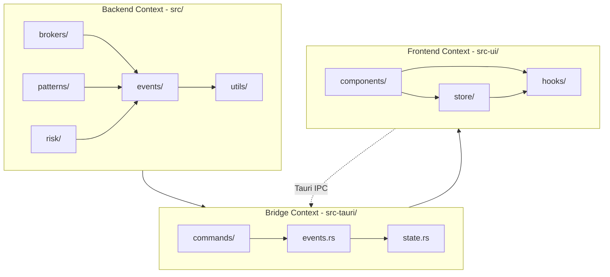

# Monorepo AI Context and Focus Strategy
**DayTrader Project - Managing AI Assistance in a Tauri Monorepo**

**Version:** 1.0  
**Date:** January 24, 2026  
**Status:** Ready for Review  
**Purpose:** Optimize AI-assisted development by scoping context effectively

---

## Executive Summary

This document provides strategies for managing AI context in the DayTrader monorepo that combines a Rust backend ([`src/`](../src)) with a planned Tauri desktop frontend ([`src-ui/`](../src-ui), [`src-tauri/`](../src-tauri)). The challenge: helping AI assistants like Kilo Code focus on relevant parts of a large codebase without loading unnecessary context.

**Key Principle:** AI context is precious—be intentional about what you include.

### Quick Reference Card

```
🎯 WORKING ON FRONTEND?
   Mention: "Working in src-ui/" or "frontend only"
   Relevant: src-ui/, src-tauri/, package.json, vite.config.ts

🔧 WORKING ON BACKEND?
   Mention: "Working in src/brokers/" or "backend only"
   Relevant: src/, Cargo.toml, specific module paths

🌉 WORKING ON INTEGRATION?
   Mention: "Working on Tauri bridge between X and Y"
   Relevant: src-tauri/src/commands/, event bridge code, both sides

📊 WORKING ON PATTERNS?
   Mention: "Working in src/patterns/" or "pattern recognition"
   Relevant: src/patterns/, src/events/, tests/
```

---

## Table of Contents

1. [Directory-Based Context Scoping](#1-directory-based-context-scoping)
2. [Task Scoping Best Practices](#2-task-scoping-best-practices)
3. [Monorepo Organization Strategies](#3-monorepo-organization-strategies)
4. [Communication Patterns](#4-communication-patterns)
5. [Practical Examples](#5-practical-examples)
6. [Tooling and Workflow](#6-tooling-and-workflow)
7. [Context Optimization Techniques](#7-context-optimization-techniques)

---

## 1. Directory-Based Context Scoping

### Current Project Structure

```
daytrader/                          # Monorepo root
├── src/                            # ⚙️ Rust Backend (~50 files)
│   ├── lib.rs, main.rs
│   ├── brokers/                    # Broker integrations (Alpaca, traits)
│   ├── patterns/                   # Pattern detection engine
│   ├── risk/                       # Risk management system
│   ├── events/                     # Event bus architecture
│   ├── execution/                  # Order execution
│   ├── config/                     # Configuration
│   ├── db/                         # Database layer
│   └── utils/                      # Utilities (logging, metrics, etc.)
│
├── src-ui/                         # 🎨 React Frontend (planned)
│   ├── main.tsx, App.tsx
│   ├── components/                 # React components
│   ├── store/                      # Zustand state stores
│   ├── hooks/                      # Custom React hooks
│   └── types/                      # TypeScript type definitions
│
├── src-tauri/                      # 🌉 Tauri Bridge Layer (planned)
│   ├── src/
│   │   ├── main.rs                 # Tauri entry point
│   │   ├── commands/               # Command handlers (frontend API)
│   │   ├── state.rs                # Application state
│   │   └── events.rs               # Event bridge
│   ├── Cargo.toml                  # Tauri dependencies
│   └── tauri.conf.json             # Tauri configuration
│
├── tests/                          # 🧪 Integration Tests
├── benches/                        # ⚡ Performance Benchmarks
├── docs/                           # 📚 Documentation
├── Cargo.toml                      # Backend dependencies
└── package.json                    # Frontend dependencies
```

### Clear Context Boundaries

The monorepo naturally divides into **three logical contexts**:

#### Context 1: Backend Core ([`src/`](../src))
**When to use:** Working on Rust business logic, data models, algorithms

**Key directories:**
- [`src/brokers/`](../src/brokers) - Broker API integrations
- [`src/patterns/`](../src/patterns) - Pattern recognition engine
- [`src/risk/`](../src/risk) - Risk management rules
- [`src/events/`](../src/events) - Event bus system
- [`src/utils/`](../src/utils) - Shared utilities

**Files you'll rarely need:**
- ❌ [`src-ui/`](../src-ui) (frontend code)
- ❌ [`package.json`](../package.json) (frontend deps)
- ❌ [`vite.config.ts`](../vite.config.ts) (frontend build)

#### Context 2: Frontend UI ([`src-ui/`](../src-ui), [`package.json`](../package.json))
**When to use:** Working on React components, UI state, styling

**Key directories:**
- [`src-ui/components/`](../src-ui/components) - React components
- [`src-ui/store/`](../src-ui/store) - State management
- [`src-ui/hooks/`](../src-ui/hooks) - Custom hooks
- [`src-ui/types/`](../src-ui/types) - TypeScript types

**Files you'll rarely need:**
- ❌ [`src/brokers/`](../src/brokers) (backend internals)
- ❌ [`src/patterns/`](../src/patterns) (pattern algorithms)
- ❌ [`Cargo.toml`](../Cargo.toml) (backend deps)

#### Context 3: Integration Bridge ([`src-tauri/`](../src-tauri))
**When to use:** Connecting frontend to backend, command handlers, events

**Key directories:**
- [`src-tauri/src/commands/`](../src-tauri/src/commands) - Tauri command handlers
- [`src-tauri/src/events.rs`](../src-tauri/src/events.rs) - Event bridge
- [`src-tauri/src/state.rs`](../src-tauri/src/state.rs) - Shared state

**You'll need both sides:**
- ✅ Backend types ([`src/brokers/types.rs`](../src/brokers/types.rs), etc.)
- ✅ Frontend state stores ([`src-ui/store/`](../src-ui/store))

### Naming Conventions That Signal Context

Use clear, path-based language in your requests:

```
✅ GOOD - Signals context clearly:
- "Working in src/patterns/ to add a new pattern"
- "Working in src-ui/components/ to build a chart"
- "Working in src-tauri/src/commands/ to add new API"
- "Updating src/brokers/alpaca/ WebSocket handler"

❌ BAD - Vague, loads too much:
- "Update the application"
- "Add new trading feature"
- "Fix the pattern system"
- "Improve the UI"
```

### .gitignore Patterns for Build Artifacts

Already configured in your [`.gitignore`](../.gitignore):

```gitignore
# Rust build artifacts (DON'T LOAD INTO AI CONTEXT)
/target/
**/*.rs.bk
Cargo.lock

# Node/Frontend build artifacts (DON'T LOAD)
node_modules/
dist/
dist-ssr/
*.local

# Tauri build artifacts (DON'T LOAD)
src-tauri/target/

# OS files (DON'T LOAD)
.DS_Store
Thumbs.db
```

**AI Implication:** When AI lists project files, these directories are **automatically excluded**. You don't need to worry about AI loading gigabytes of build artifacts.

---

## 2. Task Scoping Best Practices

### How to Phrase Requests for Focused Context

#### Pattern 1: Directory-Scoped Tasks

```
🎯 TASK: "Working in src/patterns/, add a Three White Soldiers pattern"

What AI loads:
✅ src/patterns/mod.rs
✅ src/patterns/traits.rs
✅ src/patterns/registry.rs
✅ src/patterns/candlestick.rs (similar pattern for reference)
✅ src/patterns/types.rs

What AI skips:
❌ src/brokers/* (not relevant)
❌ src/risk/* (not needed for pattern detection)
❌ src-ui/* (not relevant)
❌ Frontend config files
```

#### Pattern 2: Module-Scoped Tasks

```
🎯 TASK: "Working in src/brokers/alpaca/, fix WebSocket reconnection logic"

What AI loads:
✅ src/brokers/alpaca/websocket.rs (main focus)
✅ src/brokers/alpaca/config.rs (connection params)
✅ src/brokers/traits.rs (interface contracts)
✅ src/utils/retry.rs (retry logic)

What AI skips:
❌ src/patterns/* (unrelated)
❌ src/risk/* (unrelated)
❌ Frontend files
```

#### Pattern 3: Cross-Cutting Concerns (Use Sparingly)

```
🎯 TASK: "Add a new MarketDataUpdate event that flows from backend 
         (src/events/) through Tauri bridge (src-tauri/src/events.rs)
         to frontend (src-ui/store/marketStore.ts)"

What AI loads:
✅ src/events/types.rs (event definition)
✅ src/events/bus.rs (event publishing)
✅ src-tauri/src/events.rs (event bridge)
✅ src-ui/store/marketStore.ts (frontend handler)
✅ src-ui/types/market.ts (TypeScript types)

Explicitly mention the flow so AI knows what to load.
```

#### Pattern 4: Feature-Complete Tasks

```
🎯 TASK: "Implement pattern confidence scoring in src/patterns/,
         with performance benchmarks in benches/, and tests in tests/"

What AI loads:
✅ src/patterns/traits.rs (pattern API)
✅ src/patterns/types.rs (confidence types)
✅ benches/pattern_benchmarks.rs (benchmark template)
✅ tests/pattern_*.rs (test examples)

Mention all relevant areas upfront.
```

### When to Mention Specific File Paths vs. Broader Contexts

| Situation | Recommended Approach | Example |
|-----------|---------------------|---------|
| **Modifying existing file** | Mention exact file path | "Update [`src/patterns/engulfing.rs`](../src/patterns/engulfing.rs) to validate body size" |
| **Adding new feature to module** | Mention directory | "Working in [`src/patterns/`](../src/patterns) to add a new pattern" |
| **Cross-module refactoring** | List affected modules | "Refactor event types in [`src/events/types.rs`](../src/events/types.rs) and update consumers in [`src/patterns/`](../src/patterns) and [`src/brokers/`](../src/brokers)" |
| **Architecture-level change** | Describe component | "Redesign the risk management system ([`src/risk/`](../src/risk))" |

### Leveraging VSCode Workspace Features

#### Multi-Root Workspace (Optional)

If context separation is critical, use VSCode multi-root workspaces:

```json
// daytrader.code-workspace
{
  "folders": [
    {
      "name": "Backend (Rust)",
      "path": "src"
    },
    {
      "name": "Frontend (React)",
      "path": "src-ui"
    },
    {
      "name": "Tauri Bridge",
      "path": "src-tauri"
    },
    {
      "name": "Root Config",
      "path": "."
    }
  ],
  "settings": {
    "rust-analyzer.linkedProjects": ["Cargo.toml", "src-tauri/Cargo.toml"]
  }
}
```

**Benefit:** AI can more easily distinguish between workspace roots.

#### Task-Specific Workspaces

For deep work sessions, open specific directories:

```bash
# Frontend-only session
code src-ui/

# Backend-only session  
code src/

# Full monorepo
code .
```

---

## 3. Monorepo Organization Strategies

### Module Boundaries That Create Clear Contexts

The DayTrader project already has excellent module boundaries:



**Key Insight:** Dependencies flow **downward**. When working on:
- **Frontend:** Only needs bridge contract (command signatures, event types)
- **Backend:** Completely independent of frontend
- **Bridge:** Needs types from backend, exposes API to frontend

### Documentation Organization Approach

Keep context-specific documentation co-located:

```
src/brokers/alpaca/README.md        # Backend: Alpaca integration docs
src/patterns/README.md              # Backend: Pattern detection details
src-tauri/README.md                 # Bridge: Tauri setup guide
src-ui/README.md                    # Frontend: React component guide
docs/                               # Root: Architecture, API reference
```

**AI Workflow:** When AI asks "what's in this module?", the README provides context without loading all code.

---

## 4. Communication Patterns

### Indicating Frontend-Only Work

```
🎨 CLEAR SIGNAL: Frontend Only

"I'm working in src-ui/ to create a market data chart component.
 Use TradingView Lightweight Charts, pull data from Zustand store."

AI understands:
✅ Load src-ui/components/
✅ Load src-ui/store/marketStore.ts
✅ Check package.json for dependencies
❌ Don't load backend code
❌ Don't load Tauri bridge (unless explicitly needed)
```

### Indicating Backend-Only Work

```
⚙️ CLEAR SIGNAL: Backend Only

"I'm working in src/patterns/ to optimize pattern detection performance.
 Focus on the pattern registry and trait implementations."

AI understands:
✅ Load src/patterns/*
✅ Load src/brokers/types.rs (for Candle type)
✅ Load benches/pattern_benchmarks.rs (for performance validation)
❌ Don't load frontend
❌ Don't load Tauri bridge
```

### Indicating Integration/Bridge Work

```
🌉 CLEAR SIGNAL: Integration Work

"I'm working on the Tauri command layer (src-tauri/src/commands/market_data.rs)
 to expose pattern detection results from backend to frontend."

AI understands:
✅ Load src-tauri/src/commands/market_data.rs
✅ Load src/patterns/types.rs (backend types)
✅ Load src-ui/store/patternStore.ts (frontend consumer)
✅ Load src/events/types.rs (event definitions)

This is one of the FEW cases where cross-context loading is necessary.
```

### When to Provide Cross-Cutting Concerns

Only mention cross-cutting concerns when **explicitly relevant**:

```
🔄 WHEN TO MENTION CROSS-CUTTING:

GOOD - Relevant to task:
"Add error logging to the pattern detection flow (src/patterns/)
 using the existing logging infrastructure (src/utils/logging.rs)"

BAD - Unnecessary context:
"Add a new candlestick pattern. Here's all our error handling, 
 logging, metrics, retry logic..." 
❌ TOO MUCH CONTEXT - just focus on patterns!
```

---

## 5. Practical Examples

### Example 1: Frontend Component Task

```bash
🎯 TASK PROMPT (Good):
"Working in src-ui/components/, create a PatternList.tsx component 
 that displays detected patterns from the patternStore. Use shadcn/ui
 components for styling."

📂 RELEVANT FILES AI SHOULD LOAD:
✅ src-ui/components/PatternList.tsx (create new)
✅ src-ui/store/patternStore.ts (read pattern data)
✅ src-ui/types/patterns.ts (TypeScript types)
✅ package.json (verify shadcn/ui is installed)

🚫 FILES AI SHOULD SKIP:
❌ src/patterns/* (backend implementation)
❌ src/brokers/* (not relevant)
❌ Cargo.toml (backend dependencies)
```

### Example 2: Backend Pattern Task

```bash
🎯 TASK PROMPT (Good):
"Working in src/patterns/, implement the Doji candlestick pattern.
 Follow the same structure as HammerPattern in src/patterns/candlestick.rs.
 Add tests and benchmarks."

📂 RELEVANT FILES AI SHOULD LOAD:
✅ src/patterns/candlestick.rs (template)
✅ src/patterns/traits.rs (PatternDetector trait)
✅ src/patterns/registry.rs (registration)
✅ src/patterns/types.rs (Signal, Confidence types)
✅ tests/pattern_detection.rs (test template)
✅ benches/pattern_benchmarks.rs (benchmark template)

🚫 FILES AI SHOULD SKIP:
❌ src-ui/* (frontend)
❌ src-tauri/* (bridge)
❌ src/brokers/* (not needed for pure pattern logic)
```

### Example 3: Integration/Bridge Task

```bash
🎯 TASK PROMPT (Good):
"Working on Tauri bridge (src-tauri/src/commands/patterns.rs),
 add a get_pattern_statistics command that returns aggregated
 pattern performance data to the frontend."

📂 RELEVANT FILES AI SHOULD LOAD:
✅ src-tauri/src/commands/patterns.rs (command handler)
✅ src/patterns/registry.rs (backend data source)
✅ src/patterns/types.rs (PatternStats type)
✅ src-ui/store/patternStore.ts (frontend consumer)
✅ src-ui/types/patterns.ts (TypeScript types)

Note: This is a bridge task, so both backend and frontend context is needed.
```

### Example 4: Bad Task Prompt (Too Vague)

```bash
❌ BAD TASK PROMPT:
"Update the application to show pattern detections."

🤔 PROBLEMS:
- What does "update the application" mean?
  - Backend detection logic? (src/patterns/)
  - Frontend display? (src-ui/components/)
  - Tauri command? (src-tauri/src/commands/)
  - All of the above?

- AI will load TOO MUCH context because it's unclear.

✅ BETTER VERSION:
"Working in src-ui/components/, create a PatternAlerts component
 that displays real-time pattern detections from the patternStore
 with toast notifications."

Now AI knows: Frontend only, specific component, clear scope.
```

### Example 5: Multi-Step Task (Explicit Context)

```bash
🎯 TASK PROMPT (Good):
"Implement pattern confidence scoring across the stack:
 
 1. Backend (src/patterns/types.rs): Add confidence field to Signal
 2. Backend (src/patterns/candlestick.rs): Calculate confidence in detection
 3. Bridge (src-tauri/src/commands/patterns.rs): Include confidence in responses
 4. Frontend (src-ui/types/patterns.ts): Update TypeScript types
 5. Frontend (src-ui/components/PatternList.tsx): Display confidence visually

 Start with step 1, then proceed through the stack."

📂 AI UNDERSTANDS:
- This is a multi-context task
- Load files incrementally as we move through steps
- Backend → Bridge → Frontend flow
- Clear sequence prevents overwhelming context
```

### VSCode Commands That Help Scope Work

#### Command Palette Tasks

```
Ctrl+Shift+P (Cmd+Shift+P on Mac)

🔍 Useful Commands:
- "Files: Reveal Active File in Explorer" 
  → Shows current file's location in project tree
  
- "Search: Find in Files"
  → Scope search to specific directories
  → Example: Search only in src/patterns/

- "Tasks: Run Task"
  → Run cargo commands scoped to backend
  → Run npm commands scoped to frontend
```

#### VSCode Settings for Context Awareness

```json
// .vscode/settings.json
{
  // Show full path in file tabs (helps AI understand context)
  "workbench.editor.labelFormat": "medium",
  
  // Exclude build artifacts from search (keeps AI focused)
  "search.exclude": {
    "**/target": true,
    "**/node_modules": true,
    "**/dist": true
  },
  
  // Rust-specific settings
  "rust-analyzer.linkedProjects": [
    "Cargo.toml",
    "src-tauri/Cargo.toml"
  ],
  
  // Frontend-specific settings
  "typescript.tsdk": "node_modules/typescript/lib"
}
```

---

## 6. Tooling and Workflow

### VSCode Multi-Root Workspaces (Advanced)

For maximum context isolation, use multi-root workspaces:

**Create `daytrader.code-workspace`:**

```json
{
  "folders": [
    {
      "name": "📦 Backend Core",
      "path": "src"
    },
    {
      "name": "🎨 Frontend UI",
      "path": "src-ui"
    },
    {
      "name": "🌉 Tauri Bridge",
      "path": "src-tauri"
    },
    {
      "name": "🧪 Tests & Benches",
      "path": "tests"
    },
    {
      "name": "📚 Documentation",
      "path": "docs"
    },
    {
      "name": "⚙️ Root Config",
      "path": "."
    }
  ],
  "settings": {
    "rust-analyzer.linkedProjects": [
      "Cargo.toml",
      "src-tauri/Cargo.toml"
    ],
    "files.exclude": {
      "**/target": true,
      "**/node_modules": true
    }
  }
}
```

**Open with:** `code daytrader.code-workspace`

**Benefit:** Each folder appears as a separate root in the explorer, making context boundaries visually clear.

### Git Sparse Checkout (Not Recommended for This Project)

Sparse checkout allows cloning only specific directories:

```bash
# Clone with no files
git clone --filter=blob:none --no-checkout https://github.com/user/daytrader
cd daytrader

# Enable sparse checkout
git sparse-checkout init --cone

# Choose specific directories
git sparse-checkout set src/patterns src/events

# Checkout only those directories
git checkout main
```

**When to use:**
- ❌ **Not recommended** for active development (monorepo is manageable)
- ✅ **Potentially useful** for CI/CD pipeline optimization
- ✅ **Useful** if project grows to 100+ modules

### File Patterns for AI Context Filtering

When working with AI, you can guide context loading with glob patterns:

```
🎯 EXPLICIT PATTERN EXAMPLES:

"Focus only on files matching src/patterns/**/*.rs"
→ AI loads pattern detection module only

"Focus on src-ui/components/**/*.tsx and src-ui/store/**/*.ts"
→ AI loads frontend components and state stores

"Focus on src/brokers/alpaca/*.rs and src/utils/retry.rs"
→ AI loads Alpaca broker code and retry utilities

"Load test files: tests/**/pattern*.rs"
→ AI loads only pattern-related tests
```

### AI-Friendly README Structure

Each major directory should have a README that provides context **without requiring AI to read all code**:

**Example: [`src/patterns/README.md`](../src/patterns/README.md)**

```markdown
# Pattern Detection Module

## Purpose
Detects candlestick patterns in market data and generates trading signals.

## Key Files
- `traits.rs` - PatternDetector trait definition
- `registry.rs` - Pattern registration system
- `types.rs` - Signal, Confidence, PatternType
- `candlestick.rs` - Single-candle patterns (Hammer, Doji, etc.)
- `engulfing.rs` - Two-candle engulfing patterns
- `multi_candle.rs` - Three+ candle patterns (Morning Star, etc.)

## How It Works
1. Register patterns: `PatternRegistry::register()`
2. Feed candles: `pattern.detect(&candles)`
3. Get signals: `Signal { type: Buy/Sell, confidence: 0.0-1.0 }`

## Adding New Patterns
1. Implement `PatternDetector` trait
2. Add to `registry.rs`
3. Add tests in `tests/pattern_detection.rs`
4. Add benchmarks in `benches/pattern_benchmarks.rs`

## Dependencies
- `src/brokers/types.rs` for Candle type
- `src/events/types.rs` for event publishing
```

**AI reads this → understands module structure → asks targeted questions.**

---

## 7. Context Optimization Techniques

### Rule 1: Start Narrow, Expand as Needed

```
❌ BAD APPROACH:
"Here's my entire project structure. Now help me add a pattern."
→ AI loads everything, context window fills up, performance suffers

✅ GOOD APPROACH:
"Working in src/patterns/candlestick.rs, add a Hanging Man pattern.
 Follow the Hammer pattern structure."
→ AI loads just patterns module
→ If AI needs more context, it will ask:
   "Should this integrate with the event bus?"
   → Then you add: "Yes, check src/events/types.rs"
```

### Rule 2: Use Project Documentation as Context Shorthand

Instead of explaining the entire architecture:

```
❌ VERBOSE:
"We use an event-driven architecture where the broker publishes MarketEvent
 to an EventBus using tokio channels with a 10,000 event buffer and pattern
 detectors subscribe to NewCandle events..."

✅ CONCISE:
"See [architecture-decision-frontend-separation.md] and 
 [technical-architecture.md] for the event-driven design. I'm implementing
 a new pattern detector."

→ AI can reference docs instead of you re-explaining every time
```

### Rule 3: Leverage Type Definitions as Boundaries

TypeScript and Rust types define clear contracts:

```rust
// src-tauri/src/commands/patterns.rs
#[tauri::command]
pub async fn get_pattern_statistics() -> Result<PatternStats, String> {
    // Implementation
}
```

```typescript
// src-ui/types/patterns.ts
export interface PatternStats {
  pattern_name: string;
  total_signals: number;
  win_rate: number;
}
```

**Communication with AI:**
```
"I'm implementing get_pattern_statistics command. The return type is
 already defined in src-ui/types/patterns.ts. Fetch data from backend
 PatternRegistry (src/patterns/registry.rs)."

AI knows:
✅ Input/output contract (TypeScript type)
✅ Data source (backend registry)
✅ Implementation location (command handler)
```

### Rule 4: Use Module Documentation Headers

Add module-level docs that AI can read:

```rust
// src/patterns/mod.rs

//! # Pattern Detection Module
//!
//! Detects candlestick patterns in real-time market data.
//!
//! ## Key Types
//! - `Signal`: Pattern detection result (Buy/Sell + confidence)
//! - `PatternDetector`: Trait for implementing new patterns
//! - `PatternRegistry`: Central registry for all patterns
//!
//! ## Integration Points
//! - Consumes: `MarketEvent::NewCandle` from event bus
//! - Produces: `MarketEvent::PatternDetected` to event bus
//! - Used by: Tauri commands (`src-tauri/src/commands/patterns.rs`)

pub mod traits;
pub mod types;
pub mod candlestick;
```

**AI reads this → understands module purpose → loads only what's needed.**

### Rule 5: Use .aiignore or .cursorignore Files (If Supported)

Some AI tools support custom ignore files:

```bash
# .aiignore (hypothetical feature)
# Tell AI to never load these directories for context

**/target/
**/node_modules/
**/dist/
**/*.lock
**/Cargo.lock
**/package-lock.json

# Large generated files
**/*.pb.rs
**/*.generated.ts
```

**Check your AI tool's documentation** for context filtering features.

### Rule 6: Break Large Tasks Into Phases

Instead of:
```
❌ "Implement full Tauri UI with pattern alerts, charts, and risk dashboard"
```

Do:
```
✅ Phase 1: "Implement PatternAlerts component (src-ui/components/)"
✅ Phase 2: "Connect PatternAlerts to patternStore (src-ui/store/)"
✅ Phase 3: "Add Tauri event subscription (src-tauri/src/events.rs)"
✅ Phase 4: "Style with shadcn/ui components"
```

**Each phase loads minimal context. AI stays focused.**

---

## Summary: Best Practices Checklist

### ✅ DO:

- **Be specific about directories:** "Working in [`src/patterns/`](../src/patterns)"
- **Name exact files when modifying existing code:** "Update [`src/brokers/alpaca/websocket.rs`](../src/brokers/alpaca/websocket.rs)"
- **Start narrow, expand as needed:** Begin with one module, add context if AI asks
- **Use README files:** Let AI read module READMEs instead of all code
- **Leverage type definitions:** TypeScript/Rust types define clear contracts
- **Break tasks into phases:** Smaller tasks = focused context
- **Signal context explicitly:** "Frontend only", "Backend only", "Integration work"
- **Reference existing docs:** Point to architecture docs instead of re-explaining

### ❌ DON'T:

- **Be vague:** "Update the application" (too broad)
- **Load entire project upfront:** Let AI request more context if needed
- **Mix contexts unnecessarily:** Don't mention frontend when working on backend patterns
- **Explain architecture every time:** Use docs as reference
- **Include build artifacts:** `.gitignore` handles this, but be aware
- **Request "everything related to X":** Scope to specific paths

---

## Conclusion

The DayTrader monorepo is **well-structured** for focused AI assistance:

1. **Clear module boundaries** ([`src/brokers/`](../src/brokers), [`src/patterns/`](../src/patterns), etc.)
2. **Logical separation** (backend, frontend, bridge)
3. **Good documentation** ([`README.md`](../README.md), [`technical-architecture.md`](../technical-architecture.md))

**The key to effective AI assistance is specificity:**
- Start with a narrow scope
- Load context incrementally
- Trust the AI to ask for more if needed

By following these strategies, you can work efficiently in a large monorepo without overwhelming AI context windows or loading irrelevant code.

---

## Quick Reference: Task Templates

### Template 1: Frontend Component
```
"Working in src-ui/components/, create a [ComponentName].tsx that [does X].
 Use data from [storeName] store. Style with shadcn/ui."
```

### Template 2: Backend Feature
```
"Working in src/[module]/, implement [feature]. Follow the pattern in
 src/[module]/[reference-file].rs. Add tests and benchmarks."
```

### Template 3: Integration Task
```
"Working on Tauri bridge (src-tauri/src/commands/[file].rs), add a
 [command_name] command that exposes [backend data] to [frontend component]."
```

### Template 4: Bug Fix
```
"In src/[module]/[file].rs at line X, fix [specific issue].
 The problem is: [error/behavior]. Expected: [correct behavior]."
```

### Template 5: Refactoring
```
"Refactor [module/feature] in src/[path]/ to [improvement].
 Ensure existing tests in tests/ still pass. Update [related files]."
```

---

**Document Version:** 1.0  
**Last Updated:** January 24, 2026  
**Next Review:** After Tauri integration completion  
**Maintained By:** Development Team

---

## Related Documentation

- [Technical Architecture](../technical-architecture.md) - Overall system design
- [Tauri Thin Slice Plan](../tauri-thin-slice-plan.md) - Frontend integration plan
- [Architecture Decision: Frontend Separation](../architecture-decision-frontend-separation.md) - Monorepo rationale
- [Developer Onboarding](../docs/developer-onboarding.md) - Getting started guide
