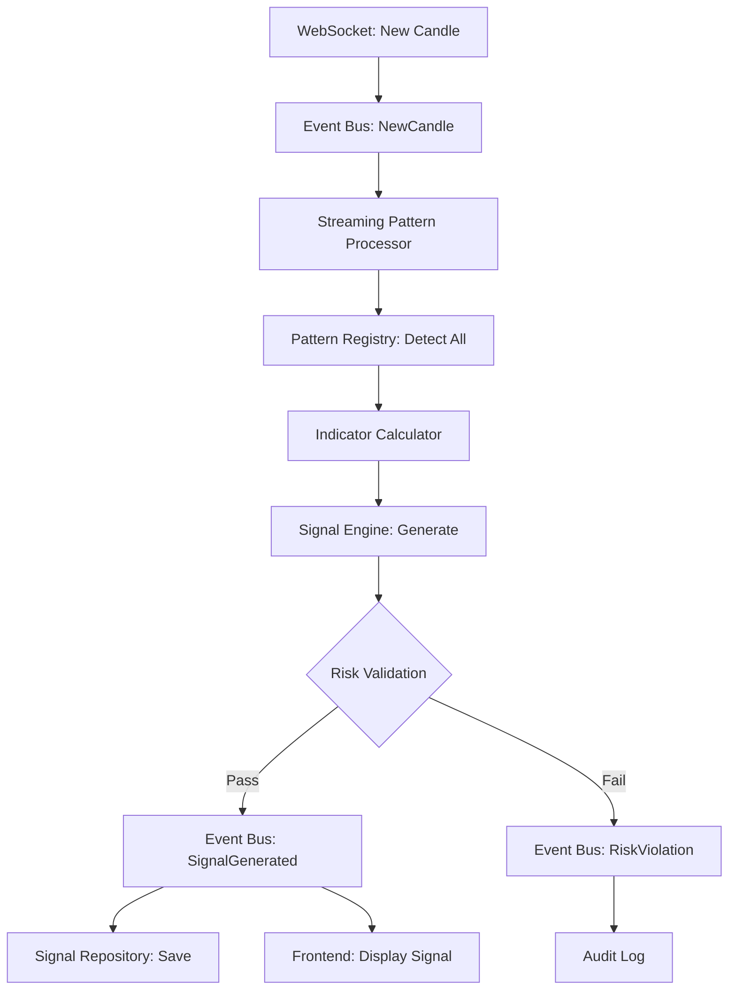

# Phase 3D: Pattern Recognition Integration & Optimization Plan

**Date:** January 25, 2026  
**Status:** Ready for Implementation  
**Version:** 1.0  
**Previous Phases:** 3A (Pattern Detection), 3B (Technical Indicators), 3C (Signal Generation) - All Complete

---

## Executive Summary

Phase 3D completes the Pattern Recognition system (Phase 3) by integrating all components with the existing infrastructure and optimizing for production performance. This phase focuses on:

1. **Database Integration** - Storing pattern results, signal history, and performance metrics
2. **Event Bus Integration** - Real-time pattern and signal distribution
3. **Performance Optimization** - Parallel processing, memory optimization, benchmarking
4. **End-to-End Integration** - Connecting patterns → indicators → signals → risk → events

### Current State Assessment

**Completed Components:**
- ✅ Phase 3A-1: Pattern Detection Framework ([`src/patterns/traits.rs`](../src/patterns/traits.rs), [`src/patterns/registry.rs`](../src/patterns/registry.rs))
- ✅ Phase 3A-2: Basic Candlestick Patterns ([`src/patterns/candlestick.rs`](../src/patterns/candlestick.rs), [`src/patterns/engulfing.rs`](../src/patterns/engulfing.rs))
- ✅ Phase 3B: Technical Indicators ([`src/patterns/indicators.rs`](../src/patterns/indicators.rs))
- ✅ Phase 3C: Signal Generation Engine ([`src/patterns/signals.rs`](../src/patterns/signals.rs))

**Integration Status:**
- ✅ Risk system integration (in signal generation)
- 🔄 Event bus integration (partial - needs real-time streaming)
- ❌ Database integration (pattern storage missing)
- ❌ Performance optimization (benchmarks incomplete)

---

## Phase 3D-1: Risk System Integration ✅ MOSTLY COMPLETE

According to [`src/patterns/signals.rs`](../src/patterns/signals.rs:800-815), the `SignalEngine` already integrates with the risk engine:

```rust
pub fn with_risk_engine(
    config: SignalConfig,
    risk_engine: Option<Arc<crate::risk::engine::RiskEngine>>,
) -> Self
```

**Remaining Work:**
- [ ] Verify risk filtering is working correctly
- [ ] Test pattern-specific risk limits integration
- [ ] Validate confidence-based position sizing
- [ ] Add integration tests for risk + signal scenarios

---

## Phase 3D-2: Database Integration 📋 PLANNED

### Objective
Store pattern detection results and signal generation history for:
- Performance analysis and backtesting
- Pattern effectiveness tracking
- Signal quality metrics
- Compliance and audit trails

### Database Schema (Already Exists)

From [`src/db/schema.sql`](../src/db/schema.sql:455-487):

```sql
-- Pattern Signals (Already defined)
CREATE TABLE pattern_signals (
    id INTEGER PRIMARY KEY AUTOINCREMENT,
    symbol TEXT NOT NULL,
    pattern_name TEXT NOT NULL,
    signal_type TEXT NOT NULL CHECK(signal_type IN ('buy', 'sell')),
    confidence REAL CHECK(confidence >= 0 AND confidence <= 1),
    detected_at TIMESTAMP NOT NULL,
    candle_timestamp TIMESTAMP NOT NULL,
    price_at_detection REAL NOT NULL,
    acted_upon BOOLEAN DEFAULT FALSE,
    order_id INTEGER,
    outcome TEXT CHECK(outcome IN ('win', 'loss', 'pending', 'ignored')),
    FOREIGN KEY (order_id) REFERENCES orders(id)
);

-- Pattern Stats (Already defined)
CREATE TABLE pattern_stats (
    id INTEGER PRIMARY KEY AUTOINCREMENT,
    pattern_name TEXT NOT NULL UNIQUE,
    total_signals INTEGER DEFAULT 0,
    total_trades INTEGER DEFAULT 0,
    winning_trades INTEGER DEFAULT 0,
    losing_trades INTEGER DEFAULT 0,
    total_profit REAL DEFAULT 0.0,
    win_rate REAL DEFAULT 0.0,
    avg_profit_per_trade REAL DEFAULT 0.0,
    consecutive_losses INTEGER DEFAULT 0,
    is_enabled BOOLEAN DEFAULT TRUE,
    last_updated TIMESTAMP DEFAULT CURRENT_TIMESTAMP
);
```

### New Database Tables Needed

**Trading Signals Storage:**
```sql
-- Comprehensive trading signals with all components
CREATE TABLE IF NOT EXISTS trading_signals (
    id TEXT PRIMARY KEY,
    symbol TEXT NOT NULL,
    signal_type TEXT NOT NULL CHECK(signal_type IN ('buy', 'sell')),
    confidence REAL NOT NULL CHECK(confidence >= 0 AND confidence <= 1),
    price_level REAL NOT NULL,
    generated_at TIMESTAMP NOT NULL,
    
    -- Market context
    trend_type TEXT,
    trend_strength REAL,
    volatility REAL,
    market_strength REAL,
    
    -- Signal components (JSON array)
    components TEXT NOT NULL,
    
    -- Metadata (JSON object)
    metadata TEXT,
    
    -- Outcome tracking
    acted_upon BOOLEAN DEFAULT FALSE,
    outcome TEXT CHECK(outcome IN ('win', 'loss', 'pending', 'ignored')),
    order_id INTEGER,
    FOREIGN KEY (order_id) REFERENCES orders(id)
);

CREATE INDEX idx_trading_signals_symbol_time ON trading_signals(symbol, generated_at DESC);
CREATE INDEX idx_trading_signals_confidence ON trading_signals(confidence DESC);
CREATE INDEX idx_trading_signals_outcome ON trading_signals(outcome);
```

**Indicator Values Storage (for analytics):**
```sql
CREATE TABLE IF NOT EXISTS indicator_values (
    id INTEGER PRIMARY KEY AUTOINCREMENT,
    symbol TEXT NOT NULL,
    indicator_name TEXT NOT NULL,
    value REAL NOT NULL,
    timestamp TIMESTAMP NOT NULL,
    metadata TEXT,
    UNIQUE(symbol, indicator_name, timestamp)
);

CREATE INDEX idx_indicator_values_symbol_time ON indicator_values(symbol, timestamp DESC);
```

### Implementation Tasks

**Week 1: Database Models and Repositories**

1. **Create Signal Repository** ([`src/db/repositories.rs`](../src/db/repositories.rs) extension):
   ```rust
   pub struct SignalRepository {
       pool: Arc<DbPool>,
   }
   
   impl SignalRepository {
       pub async fn save_trading_signal(&self, signal: &TradingSignal) -> Result<i64>;
       pub async fn save_pattern_signal(&self, signal: &PatternSignal) -> Result<i64>;
       pub async fn get_signals_for_symbol(&self, symbol: &str, limit: usize) -> Result<Vec<TradingSignal>>;
       pub async fn update_signal_outcome(&self, signal_id: &str, outcome: SignalOutcome) -> Result<()>;
   }
   ```

2. **Create Indicator Repository:**
   ```rust
   pub struct IndicatorRepository {
       pool: Arc<DbPool>,
   }
   
   impl IndicatorRepository {
       pub async fn save_indicator_value(&self, symbol: &str, name: &str, value: f64, timestamp: DateTime<Utc>) -> Result<i64>;
       pub async fn get_indicator_history(&self, symbol: &str, name: &str, limit: usize) -> Result<Vec<IndicatorValue>>;
   }
   ```

3. **Integrate Storage into Signal Engine:**
   - Add `SignalRepository` to `SignalEngine` state
   - Persist signals after generation
   - Track signal outcomes when orders complete

---

## Phase 3D-3: Performance Optimization 📋 PLANNED

### Objective
Optimize pattern recognition pipeline for sub-millisecond performance with 50+ symbols.

### Current Performance Baseline

From existing benchmarks ([`benches/pattern_benchmarks.rs`](../benches/pattern_benchmarks.rs)):
- Pattern detection: ~500-800μs per symbol (needs improvement)
- Signal generation: Not benchmarked yet

### Optimization Targets

**Phase 3D Performance Targets:**
- Pattern detection: < 100μs per symbol
- Signal generation: <100μs per symbol  
- Full pipeline (pattern + indicators + signal): < 500μs per symbol
- Support 50+ symbols in real-time (< 1 minute latency window)

### Performance Optimization Strategies

**1. Parallel Pattern Detection** ([`src/patterns/streaming.rs`](../src/patterns/streaming.rs) extension):
```rust
pub struct ParallelPatternProcessor {
    registry: Arc<PatternRegistry>,
    worker_pool_size: usize,
}

impl ParallelPatternProcessor {
    pub async fn process_symbols_parallel(
        &self,
        symbols: Vec<(Symbol, Vec<Candle>)>,
    ) -> Vec<Vec<PatternResult>> {
        use futures::stream::{self, StreamExt};
        
        stream::iter(symbols)
            .map(|(symbol, candles)| {
                let registry = self.registry.clone();
                async move {
                    registry.detect_all_patterns(&candles).await.unwrap_or_default()
                }
            })
            .buffer_unordered(self.worker_pool_size)
            .collect()
            .await
    }
}
```

**2. Incremental Indicator Updates:**
```rust
// Instead of recalculating all indicators on every candle
pub struct IncrementalIndicators {
    sma_state: SmaState,
    ema_state: EmaState,
    rsi_state: RsiState,
}

impl IncrementalIndicators {
    pub fn update_with_new_candle(&mut self, candle: &Candle) {
        // O(1) update instead of O(n) recalculation
        self.sma_state.add_price(candle.close.value());
        self.ema_state.add_price(candle.close.value());
        self.rsi_state.add_price(candle.close.value());
    }
}
```

**3. Memory Optimization:**
- Use circular buffers for candle history
- Pre-allocate vectors based on typical sizes
- Use `SmallVec` for small collections  
- Zero-copy with Arc where appropriate

**4. CPU Optimization:**
- SIMD operations for indicator calculations
- Reduce branching in hot paths
- Inline critical functions
- Cache computed values

### Benchmarking Plan

**Create Comprehensive Benchmarks:**

```rust
// benches/phase_3d_benchmarks.rs

use criterion::{black_box, criterion_group, criterion_main, Criterion, BenchmarkId};
use daytrader::patterns::*;

fn bench_end_to_end_pipeline(c: &mut Criterion) {
    let mut group = c.benchmark_group("phase_3d_pipeline");
    
    for symbols in [1, 10, 50, 100].iter() {
        group.bench_with_input(
            BenchmarkId::new("full_pipeline", symbols),
            symbols,
            |b, &num_symbols| {
                let data = generate_multi_symbol_data(num_symbols);
                b.iter(|| {
                    // Pattern detection → Indicators → Signal generation
                    process_full_pipeline(black_box(&data))
                });
            }
        );
    }
    
    group.finish();
}

fn bench_parallel_vs_sequential(c: &mut Criterion) {
    // Compare parallel processing to sequential
}

criterion_group!(benches, bench_end_to_end_pipeline, bench_parallel_vs_sequential);
criterion_main!(benches);
```

---

## Phase 3D Integration Architecture

### Real-Time Pipeline Flow



### Integration Points

**1. Event Bus Integration:**
- Subscribe to `MarketEvent::NewCandle` in streaming processor
- Publish `MarketEvent::PatternDetected` for each pattern
- Publish `MarketEvent::SignalGenerated` for composite signals
- Integrate with existing event filters

**2. Database Integration:**
- Save pattern results to `pattern_signals` table
- Save trading signals to new `trading_signals` table
- Update `pattern_stats` on signal generation
- Store indicator values for analytics

**3. Frontend Integration:**
- Tauri commands expose signal history
- Real-time signal events forwarded to UI
- Pattern performance dashboard data
- Signal alert notifications

---

## Implementation Timeline

### Week 1: Database Integration (3D-2)
**Day 1-2: Database Schema and Models**
- [ ] Create `trading_signals` table migration
- [ ] Create `indicator_values` table migration
- [ ] Add database models for `TradingSignal` struct
- [ ] Add models for `IndicatorValue` struct

**Day 3-4: Repository Implementation**
- [ ] Implement `SignalRepository` with CRUD operations
- [ ] Implement `IndicatorRepository` for indicator storage
- [ ] Add batch insert methods for performance
- [ ] Add query methods for signal history and analytics

**Day 5: Integration Testing**
- [ ] Test signal storage and retrieval
- [ ] Test indicator value persistence
- [ ] Test concurrent database access
- [ ] Verify data integrity

### Week 2: Event Bus Integration (3D-1 Enhancement)
**Day 1-2: Streaming Pipeline**
- [ ] Create `PatternStreamingPipeline` that subscribes to `NewCandle` events
- [ ] Integrate pattern detection → indicator calculation → signal generation
- [ ] Add event publishing for each pipeline stage
- [ ] Implement error handling and recovery

**Day 3-4: Event Integration**
- [ ] Subscribe to all relevant market events
- [ ] Publish pattern detection events
- [ ] Publish signal generation events
- [ ] Test event flow end-to-end

**Day 5: Frontend Integration**
- [ ] Update Tauri commands to query signal database
- [ ] Add real-time signal event forwarding
- [ ] Test UI signal display
- [ ] Verify performance metrics display

### Week 3: Performance Optimization (3D-3)
**Day 1-2: Benchmarking**
- [ ] Create comprehensive benchmark suite for Phase 3D
- [ ] Measure pattern detection performance
- [ ] Measure indicator calculation performance
- [ ] Measure signal generation performance
- [ ] Measure end-to-end pipeline latency

**Day 3-4: Optimization Implementation**
- [ ] Implement parallel pattern processing
- [ ] Add incremental indicator updates (if needed)
- [ ] Optimize memory allocations
- [ ] Cache frequently accessed data
- [ ] Add SIMD optimizations where applicable

**Day 5: Validation**
- [ ] Re-run benchmarks to measure improvements
- [ ] Profile with realistic 50-symbol workload
- [ ] Memory usage analysis
- [ ] CPU usage monitoring
- [ ] Verify no performance regressions

### Week 4: Testing and Documentation
**Day 1-2: Integration Testing**
- [ ] End-to-end pattern recognition workflow tests
- [ ] Multi-symbol concurrent processing tests
- [ ] Database integration tests
- [ ] Event flow validation tests
- [ ] Performance regression tests

**Day 3-4: Documentation**
- [ ] Create Phase 3D completion report
- [ ] Document performance characteristics
- [ ] Create integration guide for Phase 4
- [ ] Update API documentation
- [ ] Add usage examples

**Day 5: Final Review**
- [ ] Code review and refinements
- [ ] Bug fixes
- [ ] Update progress tracking
- [ ] Plan for Phase 4 transition

---

## Implementation Details

### 1. Database Integration Implementation

#### Signal Repository Structure

```rust
// src/db/repositories.rs (extension)

use crate::patterns::signals::TradingSignal;
use sqlx::{Pool, Sqlite};
use std::sync::Arc;

pub struct SignalRepository {
    pool: Arc<Pool<Sqlite>>,
}

impl SignalRepository {
    pub fn new(pool: Arc<Pool<Sqlite>>) -> Self {
        Self { pool }
    }
    
    /// Saves a trading signal to the database
    pub async fn save_trading_signal(&self, signal: &TradingSignal) -> Result<i64, sqlx::Error> {
        let components_json = serde_json::to_string(&signal.components)?;
        let metadata_json = serde_json::to_string(&signal.metadata)?;
        
        let result = sqlx::query(
            r#"
            INSERT INTO trading_signals (
                id, symbol, signal_type, confidence, price_level, generated_at,
                trend_type, trend_strength, volatility, market_strength,
                components, metadata
            )
            VALUES (?, ?, ?, ?, ?, ?, ?, ?, ?, ?, ?, ?)
            "#
        )
        .bind(&signal.id)
        .bind(signal.symbol.as_str())
        .bind(signal.signal_type.as_str())
        .bind(signal.confidence.value())
        .bind(signal.price_level.value())
        .bind(signal.generated_at)
        .bind(signal.market_context.trend.as_str()) // Need to implement
        .bind(signal.market_context.trend.strength())
        .bind(signal.market_context.volatility)
        .bind(signal.market_context.market_strength)
        .bind(components_json)
        .bind(metadata_json)
        .execute(&*self.pool)
        .await?;
        
        Ok(result.last_insert_rowid())
    }
    
    /// Retrieves recent signals for a symbol
    pub async fn get_signals_for_symbol(
        &self,
        symbol: &str,
        limit: usize,
    ) -> Result<Vec<TradingSignal>, sqlx::Error> {
        sqlx::query_as::<_, TradingSignalRow>(
            r#"
            SELECT * FROM trading_signals
            WHERE symbol = ?
            ORDER BY generated_at DESC
            LIMIT ?
            "#
        )
        .bind(symbol)
        .bind(limit as i64)
        .fetch_all(&*self.pool)
        .await
        .map(|rows| rows.into_iter().map(Into::into).collect())
    }
    
    /// Updates signal outcome when trade is closed
    pub async fn update_signal_outcome(
        &self,
        signal_id: &str,
        outcome: &str,
        order_id: Option<i64>,
    ) -> Result<(), sqlx::Error> {
        sqlx::query(
            r#"
            UPDATE trading_signals
            SET acted_upon = TRUE, outcome = ?, order_id = ?
            WHERE id = ?
            "#
        )
        .bind(outcome)
        .bind(order_id)
        .bind(signal_id)
        .execute(&*self.pool)
        .await?;
        
        Ok(())
    }
    
    /// Gets signal statistics for performance analysis
    pub async fn get_signal_statistics(
        &self,
        from_date: DateTime<Utc>,
    ) -> Result<SignalStatistics, sqlx::Error> {
        let row = sqlx::query_as::<_, SignalStatsRow>(
            r#"
            SELECT
                COUNT(*) as total_signals,
                AVG(confidence) as avg_confidence,
                SUM(CASE WHEN acted_upon THEN 1 ELSE 0 END) as acted_upon_count,
                SUM(CASE WHEN outcome = 'win' THEN 1 ELSE 0 END) as winning_signals,
                SUM(CASE WHEN outcome = 'loss' THEN 1 ELSE 0 END) as losing_signals
            FROM trading_signals
            WHERE generated_at >= ?
            "#
        )
        .bind(from_date)
        .fetch_one(&*self.pool)
        .await?;
        
        Ok(row.into())
    }
}
```

### 2. Event Bus Integration Implementation

#### Streaming Pattern Pipeline

```rust
// src/patterns/streaming.rs (enhancement)

use crate::events::{bus::EventBus, types::MarketEvent};
use crate::patterns::{PatternRegistry, signals::SignalEngine};
use std::sync::Arc;
use tokio::task::JoinHandle;

pub struct PatternStreamingPipeline {
    event_bus: EventBus,
    pattern_registry: Arc<PatternRegistry>,
    signal_engine: Arc<tokio::sync::RwLock<SignalEngine>>,
    signal_repository: Arc<crate::db::repositories::SignalRepository>,
    task_handle: Option<JoinHandle<()>>,
}

impl PatternStreamingPipeline {
    pub fn new(
        event_bus: EventBus,
        pattern_registry: Arc<PatternRegistry>,
        signal_engine: Arc<tokio::sync::RwLock<SignalEngine>>,
        signal_repository: Arc<crate::db::repositories::SignalRepository>,
    ) -> Self {
        Self {
            event_bus,
            pattern_registry,
            signal_engine,
            signal_repository,
            task_handle: None,
        }
    }
    
    /// Starts the streaming pipeline
    pub fn start(&mut self) {
        let mut rx = self.event_bus.subscribe();
        let pattern_registry = self.pattern_registry.clone();
        let signal_engine = self.signal_engine.clone();
        let signal_repository = self.signal_repository.clone();
        let event_bus = self.event_bus.clone();
        
        let handle = tokio::spawn(async move {
            while let Ok(event) = rx.recv().await {
                match event {
                    MarketEvent::NewCandle { symbol, candle } => {
                        // Process candle through full pipeline
                        if let Err(e) = Self::process_new_candle(
                            &symbol,
                            &candle,
                            &pattern_registry,
                            &signal_engine,
                            &signal_repository,
                            &event_bus,
                        ).await {
                            tracing::error!("Error processing candle: {}", e);
                        }
                    }
                    _ => {}
                }
            }
        });
        
        self.task_handle = Some(handle);
    }
    
    /// Processes a new candle through the pipeline
    async fn process_new_candle(
        symbol: &Symbol,
        candle: &Arc<Candle>,
        pattern_registry: &Arc<PatternRegistry>,
        signal_engine: &Arc<tokio::sync::RwLock<SignalEngine>>,
        signal_repository: &Arc<crate::db::repositories::SignalRepository>,
        event_bus: &EventBus,
    ) -> Result<(), Box<dyn std::error::Error>> {
        // 1. Detect patterns
        let candles = vec![(**candle).clone()]; // In real impl, get recent candles from cache
        let pattern_results = pattern_registry.detect_all_patterns(&candles).await?;
        
        // 2. Publish pattern detection events
        for pattern in &pattern_results {
            let event = MarketEvent::PatternDetected {
                signal: crate::events::types::PatternSignal {
                    symbol: symbol.clone(),
                    pattern_name: pattern.pattern_name.clone(),
                    signal_type: pattern.signal_type,
                    confidence: pattern.confidence,
                    detected_at: pattern.detected_at,
                    price: pattern.price,
                },
            };
            event_bus.publish(event);
        }
        
        // 3. Generate trading signals
        let mut engine = signal_engine.write().await;
        let signals = engine.generate_signals(&pattern_results, &candles).await?;
        
        // 4. Publish and store signals
        for signal in signals {
            // Publish event
            let event = MarketEvent::SignalGenerated {
                signal: signal.clone(),
            };
            event_bus.publish(event);
            
            // Store in database
            signal_repository.save_trading_signal(&signal).await?;
        }
        
        Ok(())
    }
}
```

### 3. Performance Monitoring

```rust
// src/utils/performance_monitor.rs (extension)

pub struct Phase3PerformanceMonitor {
    pattern_detection_times: Arc<RwLock<Vec<Duration>>>,
    indicator_calc_times: Arc<RwLock<Vec<Duration>>>,
    signal_generation_times: Arc<RwLock<Vec<Duration>>>,
}

impl Phase3PerformanceMonitor {
    pub fn record_pattern_detection(&self, duration: Duration) {
        // Record and calculate rolling averages
    }
    
    pub fn get_statistics(&self) -> PerformanceStats {
        // Return P50, P95, P99 latencies
    }
}
```

---

## Success Criteria

### Functional Requirements
- [ ] All patterns detect correctly with proper confidence scoring
- [ ] Technical indicators calculate accurately
- [ ] Signals generate with proper risk integration
- [ ] Database stores all pattern and signal data
- [ ] Event bus distributes all pattern/signal events
- [ ] Frontend displays signals in real-time

### Performance Requirements
- [ ] Pattern detection: < 100μs per symbol
- [ ] Full pipeline: < 500μs per symbol
- [ ] Support 50+ symbols concurrently
- [ ] Memory usage: < 200MB for 50 symbols
- [ ] No event drops under normal load

### Integration Requirements
- [ ] Seamless integration with existing Phase 1 (infrastructure) ✅
- [ ] Seamless integration with existing Phase 2 (risk management) ✅
- [ ] Database integration complete and tested
- [ ] Event bus integration complete and tested
- [ ] Frontend integration working with real-time updates

### Quality Requirements
- [ ] Zero compiler warnings
- [ ] >85% test coverage for pattern recognition modules
- [ ] All benchmarks passing performance targets
- [ ] Integration tests validating full pipeline
- [ ] Documentation complete with examples

---

## Risk Assessment

### Technical Risks

**Risk: Database write performance bottleneck**
- *Impact:* Signal storage could slow down real-time processing
- *Mitigation:* Async batch writes, connection pooling, write-behind caching

**Risk: Event bus overload with high signal volume**
- *Impact:* Event drops or slowdowns
- *Mitigation:* Event throttling, larger buffer sizes, backpressure handling

**Risk: Memory usage growth with 50+ symbols**
- *Impact:* System instability or slowdown
- *Mitigation:* Bounded caches, periodic cleanup, memory profiling

### Integration Risks

**Risk: Incompatibility between Phase 2 risk and Phase 3 signals**
- *Impact:* Risk filtering doesn't work correctly
- *Mitigation:* Comprehensive integration tests, staged rollout

**Risk: Performance regression when all components active**
- *Impact:* Missing sub-second latency targets
- *Mitigation:* Extensive benchmarking, profiling, optimization passes

---

## Deliverables Checklist

### Code Deliverables
- [ ] Database migration scripts for new tables
- [ ] Signal and indicator repositories
- [ ] Streaming pattern pipeline implementation
- [ ] Performance optimization enhancements
- [ ] Comprehensive benchmark suite

### Integration Deliverables
- [ ] Event bus fully integrated with pattern pipeline
- [ ] Database storage for all pattern and signal data
- [ ] Frontend integration with real-time signal display
- [ ] Risk system integration validated

### Testing Deliverables
- [ ] Integration tests for full pipeline
- [ ] Performance benchmarks for all critical paths
- [ ] Load testing with 50+ symbols
- [ ] Memory and CPU profiling results

### Documentation Deliverables
- [ ] Phase 3D completion report
- [ ] Performance optimization guide
- [ ] Integration guide for Phase 4 (Order Execution)
- [ ] API documentation updates
- [ ] Usage examples and tutorials

---

## Next Steps After Phase 3D

### Immediate Next Phase: Phase 4 - Order Execution

With Pattern Recognition complete (Phase 3), the system can:
- Detect patterns in real-time ✅
- Calculate technical indicators ✅
- Generate trading signals with confidence ✅
- Apply risk filtering ✅

**Phase 4 will add:**
- Manual order entry with risk validation
- Automated order execution based on signals
- Position tracking and P&L calculation
- Order history and trade journal

### Phase 3D → Phase 4 Handoff

Phase 4 will consume:
- `MarketEvent::SignalGenerated` events → Trigger order execution
- Signal confidence scores → Determine position size
- Risk evaluation results → Block unsafe orders
- Pattern performance stats → Enable/disable automation

---

## Conclusion

Phase 3D completes the Pattern Recognition system by:
1. Integrating all components into a cohesive real-time pipeline
2. Adding database persistence for analytics and compliance
3. Optimizing for production-level performance
4. Validating end-to-end functionality with comprehensive tests

Upon completion, the system will have a fully functional, high-performance pattern recognition engine ready to drive order execution in Phase 4.

**Estimated Timeline:** 4 weeks  
**Risk Level:** Medium (mostly integration work)  
**Dependencies:** Phase 3A, 3B, 3C complete ✅

---

**Document Version:** 1.0  
**Last Updated:** January 25, 2026  
**Status:** Ready for Implementation  
**Next Review:** After Week 2 (mid-phase checkpoint)
