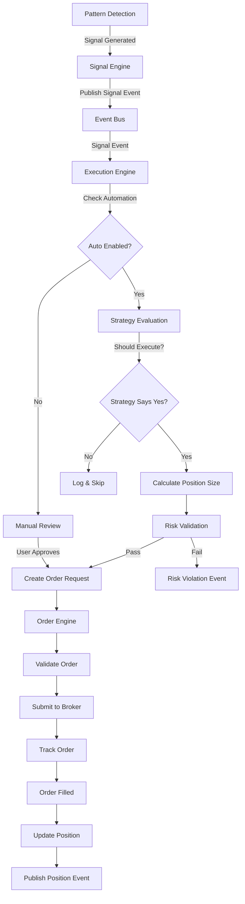
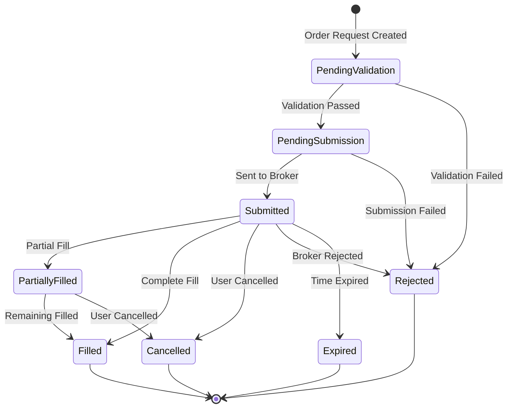
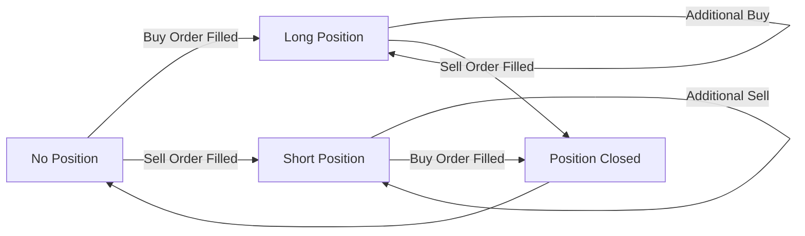
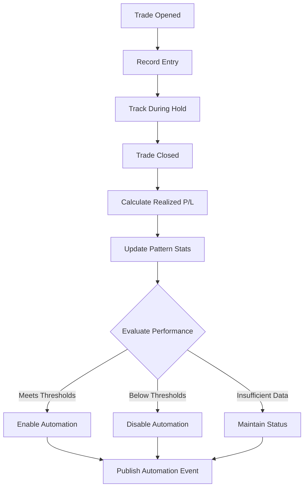

# Phase 4: Order Execution - Completion Reference

**Companion to:** [`phase-4-order-execution-plan.md`](phase-4-order-execution-plan.md)  
**Date:** January 25, 2026  
**Version:** 1.0

---

## Phase 5 Handoff (Continued)

### Event Subscriptions for UI

```rust
// Subscribe to order events
let mut order_rx = event_bus.subscribe::<OrderEvent>();
tokio::spawn(async move {
    while let Ok(event) = order_rx.recv().await {
        match event {
            OrderEvent::OrderPlaced { order } => {
                // Update UI with new order
            }
            OrderEvent::OrderFilled { order_id, fill_info } => {
                // Show fill notification
            }
            OrderEvent::OrderRejected { order_id, reason } => {
                // Alert user
            }
            _ => {}
        }
    }
});

// Subscribe to position events
let mut position_rx = event_bus.subscribe::<PositionEvent>();
tokio::spawn(async move {
    while let Ok(event) = position_rx.recv().await {
        match event {
            PositionEvent::PositionOpened { position } => {
                // Add position to dashboard
            }
            PositionEvent::PriceUpdated { symbol, unrealized_pl, .. } => {
                // Update P&L display
            }
            PositionEvent::PositionClosed { symbol, realized_pl, .. } => {
                // Show trade result
            }
            _ => {}
        }
    }
});

// Subscribe to execution events
let mut exec_rx = event_bus.subscribe::<ExecutionEvent>();
tokio::spawn(async move {
    while let Ok(event) = exec_rx.recv().await {
        match event {
            ExecutionEvent::SignalAutoExecuted { signal_id, order_id, .. } => {
                // Show automation notification
            }
            ExecutionEvent::SignalRequiresManualReview { signal_id, reason } => {
                // Prompt user for decision
            }
            _ => {}
        }
    }
});
```

---

## Mermaid Diagrams

### Signal-to-Order Pipeline



### Order Lifecycle



### Position Lifecycle



### Performance Tracking Workflow



---

## Timeline & Milestones

### Detailed Week Breakdown

**Week 16 (Days 1-5): Order Management Foundation**
- Day 1: Order types and models implementation
- Day 2-3: Order engine core with validation pipeline
- Day 4: Order status tracking system
- Day 5: Database integration for orders

**Week 17 (Days 1-5): Order Completion & Broker Integration**
- Day 1-2: Complete database repository methods
- Day 3-4: Broker adapter implementation (Alpaca)
- Day 5: Order management integration testing

**Week 18 (Days 1-5): Position Tracking & P&L**
- Day 1-2: Position tracker implementation
- Day 3: P&L calculator development
- Day 4-5: Database integration and event publishing

**Week 19 (Days 1-5): Execution Strategy & Engine**
- Day 1-2: Execution strategy implementations
- Day 3-5: Automated execution engine core

**Week 20 (Days 1-5): Performance Tracking & Integration**
- Day 1-3: Performance tracker implementation
- Day 4-5: End-to-end integration testing

**Week 21 (Days 1-5): Testing, Documentation & Final Integration**
- Day 1-2: Comprehensive test suite completion
- Day 3-4: Documentation writing
- Day 5: Final integration and refinement

---

## Validation Checklist

### Phase 4A Validation (Order Management)

- [ ] Order types compile and validate correctly
- [ ] Order engine places orders successfully
- [ ] Risk validation prevents invalid orders
- [ ] Order status tracking updates in real-time
- [ ] Database persistence works correctly
- [ ] Broker adapter submits orders to Alpaca
- [ ] Order cancellation works as expected
- [ ] Error handling covers all failure modes
- [ ] Events published for all order state changes
- [ ] Concurrent order placement handled safely

### Phase 4B Validation (Position Tracking)

- [ ] Positions created from order fills
- [ ] Position updates reflect fills accurately
- [ ] P&L calculations are mathematically correct
- [ ] Market price updates propagate properly
- [ ] Position closure logic works correctly
- [ ] Database persistence maintains integrity
- [ ] Events published for position changes
- [ ] Portfolio-level P&L aggregates correctly
- [ ] Edge cases handled (zero quantity, negative P&L)
- [ ] Concurrent price updates safe

### Phase 4C Validation (Automated Execution)

- [ ] Signals trigger automated orders
- [ ] Strategy selection works correctly
- [ ] Position sizing calculations accurate
- [ ] Automation toggles function properly
- [ ] Pattern automation controls work
- [ ] Performance tracking updates correctly
- [ ] Auto-enable/disable logic functions
- [ ] Manual review workflow operational
- [ ] Risk validation prevents violations
- [ ] End-to-end signal-to-order tested

### Phase 4D Validation (Testing & Documentation)

- [ ] Test coverage > 85%
- [ ] All integration tests pass
- [ ] Performance benchmarks meet targets
- [ ] Stress tests pass without errors
- [ ] Documentation complete and accurate
- [ ] Code examples work as shown
- [ ] API reference updated
- [ ] Integration guides written
- [ ] All compiler warnings resolved
- [ ] Production readiness confirmed

---

## Database Schema Verification

### Orders Table (Exists in schema.sql)

```sql
CREATE TABLE orders (
    id INTEGER PRIMARY KEY,
    account_id INTEGER NOT NULL,
    broker_order_id TEXT UNIQUE,
    symbol TEXT NOT NULL,
    side TEXT NOT NULL,
    order_type TEXT NOT NULL,
    quantity INTEGER NOT NULL,
    filled_quantity INTEGER DEFAULT 0,
    limit_price REAL,
    stop_price REAL,
    trailing_percent REAL,
    status TEXT NOT NULL,
    time_in_force TEXT DEFAULT 'day',
    submitted_at TIMESTAMP DEFAULT CURRENT_TIMESTAMP,
    filled_at TIMESTAMP,
    filled_avg_price REAL,
    commission REAL DEFAULT 0.0,
    error_message TEXT,
    is_pattern_trade BOOLEAN DEFAULT FALSE,
    pattern_name TEXT,
    FOREIGN KEY (account_id) REFERENCES accounts(id)
);

CREATE INDEX idx_orders_account_time ON orders(account_id, submitted_at DESC);
CREATE INDEX idx_orders_symbol ON orders(symbol);
CREATE INDEX idx_orders_status ON orders(status);
CREATE INDEX idx_orders_pattern ON orders(pattern_name) WHERE is_pattern_trade = TRUE;
```

### Positions Table (Exists in schema.sql)

```sql
CREATE TABLE positions (
    id INTEGER PRIMARY KEY,
    account_id INTEGER NOT NULL,
    symbol TEXT NOT NULL,
    quantity INTEGER NOT NULL,
    avg_entry_price REAL NOT NULL,
    current_price REAL,
    market_value REAL,
    unrealized_pl REAL,
    unrealized_pl_percent REAL,
    opened_at TIMESTAMP NOT NULL,
    updated_at TIMESTAMP DEFAULT CURRENT_TIMESTAMP,
    FOREIGN KEY (account_id) REFERENCES accounts(id),
    UNIQUE(account_id, symbol)
);

CREATE INDEX idx_positions_account ON positions(account_id);
CREATE INDEX idx_positions_symbol ON positions(symbol);
```

### Trades Table (Exists in schema.sql)

```sql
CREATE TABLE trades (
    id INTEGER PRIMARY KEY,
    account_id INTEGER NOT NULL,
    order_id INTEGER NOT NULL,
    symbol TEXT NOT NULL,
    side TEXT NOT NULL,
    quantity INTEGER NOT NULL,
    price REAL NOT NULL,
    commission REAL DEFAULT 0.0,
    realized_pl REAL,
    executed_at TIMESTAMP NOT NULL,
    is_day_trade BOOLEAN DEFAULT FALSE,
    pattern_name TEXT,
    notes TEXT,
    FOREIGN KEY (account_id) REFERENCES accounts(id),
    FOREIGN KEY (order_id) REFERENCES orders(id)
);

CREATE INDEX idx_trades_account_time ON trades(account_id, executed_at DESC);
CREATE INDEX idx_trades_symbol ON trades(symbol);
CREATE INDEX idx_trades_pattern ON trades(pattern_name) WHERE pattern_name IS NOT NULL;
```

---

## Code Examples

### Placing an Order

```rust
use crate::orders::{OrderEngine, OrderRequest, OrderSide, OrderType, TimeInForce};
use crate::brokers::Symbol;
use crate::orders::Quantity;

async fn place_market_buy_order(
    order_engine: &OrderEngine,
    symbol: &str,
    shares: u32,
) -> Result<OrderId, OrderError> {
    let request = OrderRequest {
        symbol: Symbol::new(symbol),
        side: OrderSide::Buy,
        order_type: OrderType::Market,
        quantity: Quantity::new(shares),
        limit_price: None,
        stop_price: None,
        trailing_percent: None,
        time_in_force: TimeInForce::Day,
        pattern_name: None,
        signal_id: None,
        signal_confidence: None,
    };
    
    order_engine.place_order(request).await
}
```

### Monitoring Positions

```rust
use crate::positions::PositionTracker;

async fn monitor_positions(position_tracker: &PositionTracker) {
    // Get all current positions
    let positions = position_tracker.get_all_positions().await?;
    
    for position in positions {
        println!("Symbol: {}", position.symbol);
        println!("Quantity: {}", position.quantity.value());
        println!("Entry Price: ${:.2}", position.avg_entry_price.value());
        println!("Current Price: ${:.2}", position.current_price.value());
        println!("Unrealized P&L: ${:.2} ({:.2}%)",
            position.unrealized_pl,
            position.unrealized_pl_percent * Decimal::from(100)
        );
        println!("---");
    }
}
```

### Configuring Automated Execution

```rust
use crate::execution::{ExecutionEngine, ExecutionConfig, ConservativeStrategy};
use std::collections::HashMap;

async fn setup_automation(
    order_engine: Arc<OrderEngine>,
    risk_engine: Arc<RiskEngine>,
    signal_engine: Arc<RwLock<SignalEngine>>,
    event_bus: EventBus,
    db_pool: Arc<SqlitePool>,
) -> Result<ExecutionEngine, ExecutionError> {
    // Configure execution settings
    let config = ExecutionConfig {
        auto_execution_enabled: true,
        min_auto_confidence: Decimal::new(75, 2),  // 0.75
        manual_confirm_below: Decimal::new(70, 2),  // 0.70
        pattern_auto_enabled: HashMap::from([
            ("bullish_engulfing".to_string(), true),
            ("morning_star".to_string(), true),
            ("hammer".to_string(), false),  // Requires manual review
        ]),
        strategy: "conservative".to_string(),
        max_orders_per_day: 10,
        max_auto_value_per_day: Decimal::new(10000, 0),  // $10,000
    };
    
    // Create conservative strategy
    let strategy = Arc::new(ConservativeStrategy::new(ConservativeConfig {
        min_confidence: Decimal::new(75, 2),
        position_size_percent: Decimal::new(5, 2),  // 5%
        max_positions: 5,
    }));
    
    // Create execution engine
    ExecutionEngine::new(
        order_engine,
        position_tracker,
        risk_engine,
        signal_engine,
        event_bus,
        db_pool,
        strategy,
        config,
    ).await
}
```

### Tracking Pattern Performance

```rust
use crate::execution::PerformanceTracker;

async fn evaluate_pattern(
    perf_tracker: &PerformanceTracker,
    pattern_name: &str,
) {
    // Get performance statistics
    let perf = perf_tracker.get_pattern_performance(pattern_name).await?;
    
    println!("Pattern: {}", perf.pattern_name);
    println!("Total Trades: {}", perf.total_trades);
    println!("Win Rate: {:.1}%", perf.win_rate * Decimal::from(100));
    println!("Average Profit: ${:.2}", perf.avg_profit_per_trade);
    println!("Total Profit: ${:.2}", perf.total_profit);
    println!("Consecutive Losses: {}", perf.consecutive_losses);
    println!("Automation Enabled: {}", perf.is_enabled);
    
    // Evaluate if should auto-enable
    let thresholds = PerformanceThresholds {
        min_trades_for_automation: 20,
        min_win_rate: Decimal::new(60, 2),  // 60%
        max_consecutive_losses: 3,
        min_avg_profit: Decimal::new(1000, 2),  // $10.00
    };
    
    let decision = perf_tracker.evaluate_pattern_automation(
        pattern_name,
        &thresholds,
    ).await?;
    
    match decision {
        AutomationDecision::Enable { reason } => {
            println!("✅ Automation should be ENABLED: {}", reason);
        }
        AutomationDecision::Disable { reason } => {
            println!("❌ Automation should be DISABLED: {}", reason);
        }
        AutomationDecision::Maintain { reason } => {
            println!("⏸️  Automation status MAINTAINED: {}", reason);
        }
    }
}
```

---

## Lessons Learned from Phase 3 (To Apply)

### 1. Type Safety Prevents Bugs
- Use newtype pattern for all domain concepts
- Validation in constructors catches errors early
- Compiler enforces correctness

**Application to Phase 4:**
- `OrderId`, `Quantity`, `LimitPrice` all newtyped
- Position calculations type-safe
- No runtime type errors

### 2. Pure Functions Enable Testing
- Deterministic behavior
- Easy to reason about
- Trivial to test

**Application to Phase 4:**
- P&L calculations are pure functions
- Position size calculations pure
- Strategy decision logic pure

### 3. Arc<T> is Efficient
- Sub-microsecond cloning
- Enables zero-copy architecture
- Perfect for event distribution

**Application to Phase 4:**
- Order events use `Arc<Order>`
- Position events use `Arc<Position>`
- Zero-copy throughout

### 4. Event-Driven Scales Well
- Loose coupling between modules
- Easy to add subscribers
- Supports future extensibility

**Application to Phase 4:**
- Order events for UI updates
- Position events for monitoring
- Execution events for automation

### 5. Benchmarking is Essential
- Catches performance regressions early
- Validates optimization efforts
- Provides concrete metrics

**Application to Phase 4:**
- Order placement latency benchmarks
- Position update benchmarks
- Database write benchmarks
- Full pipeline benchmarks

---

## Next Steps After Phase 4

### Immediate Priorities

1. **Paper Trading Validation** (1-2 weeks)
   - Run system in paper trading mode
   - Validate all orders execute correctly
   - Monitor performance and errors
   - Gather real-world data

2. **Phase 4 Completion Report** (1 week)
   - Document achievements
   - Capture metrics and benchmarks
   - Identify lessons learned
   - Prepare handoff to Phase 5

3. **Phase 5 Planning** (Concurrent with paper trading)
   - Define UI requirements
   - Design Tauri command interfaces
   - Plan React component architecture
   - Establish UX patterns

### Phase 5 Preview

**Phase 5: User Interface (Weeks 22-25)**

Sub-phases:
- **5A**: Core UI Components (charting, order entry, dashboards)
- **5B**: Real-Time Monitoring (live updates, WebSocket integration)
- **5C**: Configuration & Controls (settings, automation toggles)
- **5D**: Polish & Refinement (UX improvements, accessibility)

**Key Deliverables:**
- Real-time trading dashboard
- Order management interface
- Position monitoring views
- Pattern signal displays
- Risk status indicators
- Automation control panel
- Trade history views
- Performance analytics

---

## Critical Success Factors

### Must-Have Features

1. **Order Placement Reliability**
   - 99.9% successful submission rate
   - < 100ms average latency
   - Comprehensive error recovery

2. **Position Accuracy**
   - 100% accurate position tracking
   - Real-time P&L calculations
   - Reconciliation with broker

3. **Risk Integration**
   - Zero risk violations
   - Pre-trade validation 100% effective
   - PDT compliance guaranteed

4. **Automation Safety**
   - Performance-based enable/disable
   - Manual override always available
   - Clear audit trail

### Nice-to-Have Features (Phase 5+)

1. **Advanced Order Types**
   - One-Cancels-Other (OCO)
   - Bracket orders with automated stops
   - Iceberg orders for large positions

2. **Portfolio Analytics**
   - Risk-adjusted returns (Sharpe ratio)
   - Maximum drawdown tracking
   - Trade distribution analysis

3. **Machine Learning Integration**
   - Pattern success prediction
   - Optimal position sizing
   - Entry/exit timing optimization

---

## Appendices

### A. Glossary

**Order Types:**
- **Market Order**: Execute immediately at best available price
- **Limit Order**: Execute only at specified price or better
- **Stop Order**: Trigger market order when price reaches stop level
- **Stop-Limit**: Trigger limit order when price reaches stop level
- **Trailing Stop**: Stop price follows market price at specified distance

**Position Terms:**
- **Long Position**: Ownership of security, profit from price increase
- **Short Position**: Borrowed security sold, profit from price decrease
- **Cost Basis**: Total amount paid for position including commissions
- **Realized P&L**: Profit/loss from closed positions
- **Unrealized P&L**: Profit/loss from open positions (mark-to-market)

**Execution Terms:**
- **Fill**: Complete execution of order
- **Partial Fill**: Incomplete execution of order
- **Slippage**: Difference between expected and actual execution price
- **Commission**: Fee charged by broker for trade execution

### B. References

**Phase 3 Documents:**
- [`reports/phase-3-pattern-recognition-completion.md`](../reports/phase-3-pattern-recognition-completion.md)
- [`plans/phase-3d-integration-optimization-plan.md`](phase-3d-integration-optimization-plan.md)

**Architecture Documents:**
- [`plans/technical-architecture.md`](technical-architecture.md)
- [`plans/consolidated-planning.md`](consolidated-planning.md)

**Risk Management:**
- [`docs/pdt-implementation-guide.md`](../docs/pdt-implementation-guide.md)
- Risk engine implementation

**Broker Integration:**
- [`src/brokers/alpaca/README.md`](../src/brokers/alpaca/README.md)
- Alpaca API documentation

---

**Document Version:** 1.0  
**Completion Date:** TBD (Target: Week 21)  
**Status:** Planning Phase  
**Next Review:** After Week 16 completion
