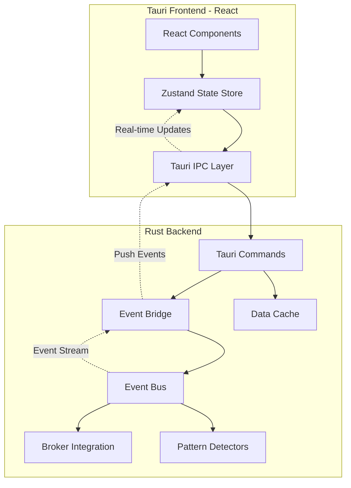
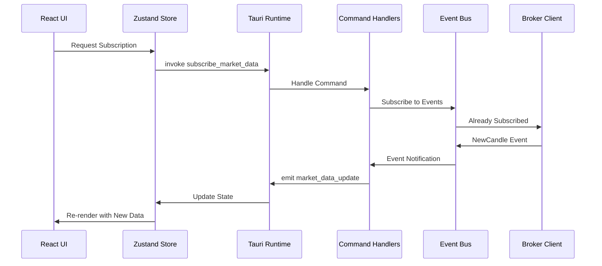

# Tauri Thin Slice Implementation Plan
**DayTrader Project - Frontend Integration**

**Date:** January 24, 2026  
**Version:** 1.0  
**Status:** Planning Phase  
**Target:** Minimal working Tauri frontend connected to existing backend

---

## Executive Summary

This plan outlines a "thin slice" approach to integrate a minimal Tauri frontend with the existing DayTrader Rust backend. The goal is to deliver visible progress through a working UI while maintaining the functional programming principles and event-driven architecture already established.

### Current State
- ✅ Phase 0 (Setup) - Complete
- ✅ Phase 1 (Core Infrastructure) - Complete  
- ✅ Phase 3A-1 (Pattern Detection Framework) - Complete
- ✅ Phase 3A-2 (Basic Candlestick Patterns) - Complete
- ❌ Phase 2 (Risk Management) - Not started
- ❌ Phase 4 (Order Execution) - Not started
- ❌ Phase 5 (Tauri UI) - Not started

### Thin Slice Objectives
1. Initialize Tauri application with React + TypeScript frontend
2. Create minimal Tauri command handlers for backend communication
3. Display real-time market data from existing broker integration
4. Show detected patterns from Phase 3A-2 implementation
5. Display basic system status and metrics
6. Maintain existing architecture integrity

---

## Architecture Overview

### System Integration Architecture



### Event Flow Architecture



---

## Minimal Feature Set

### Phase 1: Tauri Initialization & Setup

#### 1.1 Tauri Project Structure
```
src-tauri/
├── Cargo.toml                 # Tauri backend dependencies
├── tauri.conf.json           # Tauri configuration
├── src/
│   ├── main.rs               # Tauri entry point
│   ├── commands/             # Tauri command handlers
│   │   ├── mod.rs
│   │   ├── market_data.rs    # Market data commands
│   │   ├── patterns.rs       # Pattern detection commands
│   │   └── system.rs         # System status commands
│   ├── state.rs              # Application state management
│   └── events.rs             # Event bridge implementation
└── icons/                    # Application icons

src/                          # Frontend (React)
├── main.tsx                  # React entry point
├── App.tsx                   # Main application component
├── store/                    # Zustand state management
│   ├── marketStore.ts        # Market data state
│   ├── patternStore.ts       # Pattern detection state
│   └── systemStore.ts        # System status state
├── components/               # React components
│   ├── MarketData.tsx        # Market data display
│   ├── PatternList.tsx       # Pattern detection display
│   ├── SystemStatus.tsx      # System metrics display
│   └── ConnectionStatus.tsx  # Connection indicator
├── hooks/                    # Custom React hooks
│   ├── useMarketData.ts      # Market data hook
│   ├── usePatterns.ts        # Pattern detection hook
│   └── useTauriEvents.ts     # Event listener hook
└── types/                    # TypeScript types
    ├── market.ts             # Market data types
    ├── patterns.ts           # Pattern types
    └── system.ts             # System types
```

#### 1.2 Dependencies to Add

**Tauri Backend (`src-tauri/Cargo.toml`):**
```toml
[dependencies]
tauri = { version = "1.5", features = ["api-all"] }
tokio = { version = "1.35", features = ["full"] }
serde = { version = "1.0", features = ["derive"] }
serde_json = "1.0"

# Reference existing workspace crate
daytrader = { path = ".." }
```

**Frontend (`package.json`):**
```json
{
  "dependencies": {
    "react": "^18.2.0",
    "react-dom": "^18.2.0",
    "@tauri-apps/api": "^1.5.0",
    "zustand": "^4.4.0",
    "lightweight-charts": "^4.1.0"
  },
  "devDependencies": {
    "@tauri-apps/cli": "^1.5.0",
    "@vitejs/plugin-react": "^4.2.0",
    "vite": "^5.0.0",
    "typescript": "^5.3.0"
  }
}
```

### Phase 2: Backend Integration Layer

#### 2.1 Tauri Command Handlers

**Market Data Commands (`src-tauri/src/commands/market_data.rs`):**
```rust
use tauri::State;
use daytrader::brokers::types::{Symbol, Candle, Quote};
use daytrader::events::types::MarketEvent;
use crate::state::AppState;

#[tauri::command]
pub async fn get_latest_quote(
    symbol: String,
    state: State<'_, AppState>
) -> Result<Quote, String> {
    // Get from cache or broker
    let symbol = Symbol::new(&symbol)
        .map_err(|e| format!("Invalid symbol: {}", e))?;
    
    state.market_cache
        .get_latest_quote(&symbol)
        .ok_or_else(|| "No quote available".to_string())
}

#[tauri::command]
pub async fn get_recent_candles(
    symbol: String,
    count: usize,
    state: State<'_, AppState>
) -> Result<Vec<Candle>, String> {
    let symbol = Symbol::new(&symbol)
        .map_err(|e| format!("Invalid symbol: {}", e))?;
    
    state.market_cache
        .get_recent_candles(&symbol, count)
        .map_err(|e| format!("Failed to get candles: {}", e))
}

#[tauri::command]
pub async fn subscribe_symbol(
    symbol: String,
    state: State<'_, AppState>
) -> Result<(), String> {
    let symbol = Symbol::new(&symbol)
        .map_err(|e| format!("Invalid symbol: {}", e))?;
    
    state.broker
        .subscribe_quotes(vec![symbol.to_string()])
        .await
        .map_err(|e| format!("Subscription failed: {}", e))
}
```

**Pattern Commands (`src-tauri/src/commands/patterns.rs`):**
```rust
use tauri::State;
use daytrader::patterns::{PatternRegistry, PatternContext};
use daytrader::events::types::PatternSignal;
use crate::state::AppState;

#[tauri::command]
pub async fn get_detected_patterns_for_symbol(
    symbol: String,
    state: State<'_, AppState>
) -> Result<Vec<PatternSignal>, String> {
    // Get recent patterns from event history or pattern cache
    state.pattern_cache
        .get_patterns_for_symbol(&symbol)
        .map_err(|e| format!("Failed to get patterns: {}", e))
}

#[tauri::command]
pub async fn get_pattern_statistics(
    state: State<'_, AppState>
) -> Result<PatternStats, String> {
    // Return aggregated pattern performance stats
    state.pattern_registry
        .get_statistics()
        .map_err(|e| format!("Failed to get stats: {}", e))
}

#[derive(serde::Serialize)]
pub struct PatternStats {
    pub total_detections: u64,
    pub patterns_by_type: Vec<(String, u64)>,
    pub average_confidence: f64,
}
```

**System Commands (`src-tauri/src/commands/system.rs`):**
```rust
use tauri::State;
use crate::state::AppState;

#[tauri::command]
pub async fn get_system_status(
    state: State<'_, AppState>
) -> Result<SystemStatus, String> {
    Ok(SystemStatus {
        broker_connected: state.broker_connected.load(Ordering::Relaxed),
        event_bus_active: state.event_bus.subscriber_count() > 0,
        patterns_active: state.pattern_registry.enabled_count(),
        events_published: state.event_bus.events_published(),
        events_dropped: state.event_bus.events_dropped(),
        average_latency_ms: state.event_bus.get_average_latency_ns() / 1_000_000.0,
    })
}

#[derive(serde::Serialize)]
pub struct SystemStatus {
    pub broker_connected: bool,
    pub event_bus_active: bool,
    pub patterns_active: usize,
    pub events_published: u64,
    pub events_dropped: u64,
    pub average_latency_ms: f64,
}
```

#### 2.2 Event Bridge Implementation

**Event Bridge (`src-tauri/src/events.rs`):**
```rust
use tauri::{AppHandle, Manager};
use daytrader::events::{bus::EventBus, types::MarketEvent};
use tokio::task::JoinHandle;
use std::sync::Arc;

/// Bridges Rust event bus to Tauri frontend events
pub struct EventBridge {
    app_handle: AppHandle,
    event_bus: EventBus,
    task_handle: Option<JoinHandle<()>>,
}

impl EventBridge {
    pub fn new(app_handle: AppHandle, event_bus: EventBus) -> Self {
        Self {
            app_handle,
            event_bus,
            task_handle: None,
        }
    }
    
    /// Start listening to backend events and forward to frontend
    pub fn start(&mut self) {
        let mut rx = self.event_bus.subscribe();
        let app_handle = self.app_handle.clone();
        
        let handle = tokio::spawn(async move {
            while let Ok(event) = rx.recv().await {
                let _ = Self::forward_event(&app_handle, event);
            }
        });
        
        self.task_handle = Some(handle);
    }
    
    fn forward_event(app_handle: &AppHandle, event: MarketEvent) -> Result<(), tauri::Error> {
        match event {
            MarketEvent::NewCandle { candle } => {
                app_handle.emit_all("market_data:new_candle", &*candle)?;
            }
            MarketEvent::QuoteUpdate { quote } => {
                app_handle.emit_all("market_data:quote_update", &*quote)?;
            }
            MarketEvent::PatternDetected { signal } => {
                app_handle.emit_all("patterns:detected", &signal)?;
            }
            MarketEvent::ConnectionEstablished { broker } => {
                app_handle.emit_all("system:connection", broker)?;
            }
            MarketEvent::ConnectionLost { broker } => {
                app_handle.emit_all("system:disconnection", broker)?;
            }
            _ => {
                // Other events not needed for thin slice
            }
        }
        Ok(())
    }
}
```

#### 2.3 Application State

**State Management (`src-tauri/src/state.rs`):**
```rust
use daytrader::{
    brokers::traits::MarketDataProvider,
    events::bus::EventBus,
    patterns::PatternRegistry,
};
use std::sync::Arc;
use std::sync::atomic::{AtomicBool, Ordering};

pub struct AppState {
    pub event_bus: EventBus,
    pub broker: Arc<dyn MarketDataProvider>,
    pub broker_connected: Arc<AtomicBool>,
    pub pattern_registry: Arc<PatternRegistry>,
    pub market_cache: Arc<MarketDataCache>,
    pub pattern_cache: Arc<PatternCache>,
}

impl AppState {
    pub fn new(
        event_bus: EventBus,
        broker: Arc<dyn MarketDataProvider>,
        pattern_registry: Arc<PatternRegistry>,
    ) -> Self {
        Self {
            event_bus,
            broker,
            broker_connected: Arc::new(AtomicBool::new(false)),
            pattern_registry,
            market_cache: Arc::new(MarketDataCache::new()),
            pattern_cache: Arc::new(PatternCache::new()),
        }
    }
}

// Simplified cache implementations for thin slice
pub struct MarketDataCache {
    // Use existing data structures from daytrader
}

pub struct PatternCache {
    // Store recent pattern detections
}
```

### Phase 3: Frontend Implementation

#### 3.1 Zustand State Stores

**Market Data Store (`src/store/marketStore.ts`):**
```typescript
import { create } from 'zustand';
import { invoke } from '@tauri-apps/api/tauri';
import { listen } from '@tauri-apps/api/event';

interface Quote {
  symbol: string;
  bid: number;
  ask: number;
  last: number;
  timestamp: string;
}

interface Candle {
  symbol: string;
  timestamp: string;
  open: number;
  high: number;
  low: number;
  close: number;
  volume: number;
}

interface MarketStore {
  quotes: Map<string, Quote>;
  candles: Map<string, Candle[]>;
  subscribeToSymbol: (symbol: string) => Promise<void>;
  getLatestQuote: (symbol: string) => Promise<Quote>;
  getRecentCandles: (symbol: string, count: number) => Promise<Candle[]>;
}

export const useMarketStore = create<MarketStore>((set, get) => ({
  quotes: new Map(),
  candles: new Map(),
  
  subscribeToSymbol: async (symbol: string) => {
    await invoke('subscribe_symbol', { symbol });
    
    // Listen for updates
    listen<Quote>('market_data:quote_update', (event) => {
      set(state => {
        const newQuotes = new Map(state.quotes);
        newQuotes.set(event.payload.symbol, event.payload);
        return { quotes: newQuotes };
      });
    });
    
    listen<Candle>('market_data:new_candle', (event) => {
      set(state => {
        const newCandles = new Map(state.candles);
        const symbolCandles = newCandles.get(event.payload.symbol) || [];
        newCandles.set(event.payload.symbol, [...symbolCandles, event.payload]);
        return { candles: newCandles };
      });
    });
  },
  
  getLatestQuote: async (symbol: string) => {
    return invoke<Quote>('get_latest_quote', { symbol });
  },
  
  getRecentCandles: async (symbol: string, count: number) => {
    return invoke<Candle[]>('get_recent_candles', { symbol, count });
  },
}));
```

**Pattern Store (`src/store/patternStore.ts`):**
```typescript
import { create } from 'zustand';
import { invoke } from '@tauri-apps/api/tauri';
import { listen } from '@tauri-apps/api/event';

interface PatternSignal {
  symbol: string;
  pattern_name: string;
  signal_type: 'Buy' | 'Sell';
  confidence: number;
  detected_at: string;
  price: number;
}

interface PatternStore {
  patterns: PatternSignal[];
  statistics: PatternStats | null;
  loadStatistics: () => Promise<void>;
}

export const usePatternStore = create<PatternStore>((set) => ({
  patterns: [],
  statistics: null,
  
  loadStatistics: async () => {
    const stats = await invoke<PatternStats>('get_pattern_statistics');
    set({ statistics: stats });
  },
}));

// Listen for pattern detections
listen<PatternSignal>('patterns:detected', (event) => {
  usePatternStore.setState(state => ({
    patterns: [event.payload, ...state.patterns].slice(0, 100) // Keep last 100
  }));
});
```

**System Store (`src/store/systemStore.ts`):**
```typescript
import { create } from 'zustand';
import { invoke } from '@tauri-apps/api/tauri';

interface SystemStatus {
  broker_connected: boolean;
  event_bus_active: boolean;
  patterns_active: number;
  events_published: number;
  events_dropped: number;
  average_latency_ms: number;
}

interface SystemStore {
  status: SystemStatus | null;
  refreshStatus: () => Promise<void>;
}

export const useSystemStore = create<SystemStore>((set) => ({
  status: null,
  
  refreshStatus: async () => {
    const status = await invoke<SystemStatus>('get_system_status');
    set({ status });
  },
}));

// Poll status every 5 seconds
setInterval(() => {
  useSystemStore.getState().refreshStatus();
}, 5000);
```

#### 3.2 React Components

**Market Data Display (`src/components/MarketData.tsx`):**
```typescript
import React, { useEffect } from 'react';
import { useMarketStore } from '../store/marketStore';

export const MarketData: React.FC<{ symbol: string }> = ({ symbol }) => {
  const { quotes, getLatestQuote, subscribeToSymbol } = useMarketStore();
  const quote = quotes.get(symbol);
  
  useEffect(() => {
    subscribeToSymbol(symbol);
    getLatestQuote(symbol);
  }, [symbol]);
  
  if (!quote) return <div>Loading {symbol}...</div>;
  
  return (
    <div className="market-data-card">
      <h3>{symbol}</h3>
      <div className="quote-details">
        <div>Bid: ${quote.bid.toFixed(2)}</div>
        <div>Ask: ${quote.ask.toFixed(2)}</div>
        <div>Last: ${quote.last.toFixed(2)}</div>
        <div className="timestamp">{new Date(quote.timestamp).toLocaleTimeString()}</div>
      </div>
    </div>
  );
};
```

**Pattern List (`src/components/PatternList.tsx`):**
```typescript
import React from 'react';
import { usePatternStore } from '../store/patternStore';

export const PatternList: React.FC = () => {
  const { patterns } = usePatternStore();
  
  return (
    <div className="pattern-list">
      <h3>Detected Patterns</h3>
      {patterns.length === 0 ? (
        <div>No patterns detected yet</div>
      ) : (
        <ul>
          {patterns.map((pattern, index) => (
            <li key={index} className={`pattern-${pattern.signal_type.toLowerCase()}`}>
              <strong>{pattern.pattern_name}</strong>
              {' '}{pattern.symbol}
              {' '}({pattern.signal_type})
              {' '}Confidence: {(pattern.confidence * 100).toFixed(1)}%
              <div className="pattern-time">
                {new Date(pattern.detected_at).toLocaleString()}
              </div>
            </li>
          ))}
        </ul>
      )}
    </div>
  );
};
```

**System Status (`src/components/SystemStatus.tsx`):**
```typescript
import React from 'react';
import { useSystemStore } from '../store/systemStore';

export const SystemStatus: React.FC = () => {
  const { status } = useSystemStore();
  
  if (!status) return <div>Loading system status...</div>;
  
  return (
    <div className="system-status">
      <h3>System Status</h3>
      <div className="status-grid">
        <div className={`status-item ${status.broker_connected ? 'connected' : 'disconnected'}`}>
          Broker: {status.broker_connected ? '✓ Connected' : '✗ Disconnected'}
        </div>
        <div className="status-item">
          Event Bus: {status.event_bus_active ? 'Active' : 'Inactive'}
        </div>
        <div className="status-item">
          Active Patterns: {status.patterns_active}
        </div>
        <div className="status-item">
          Events Published: {status.events_published.toLocaleString()}
        </div>
        <div className="status-item">
          Events Dropped: {status.events_dropped.toLocaleString()}
        </div>
        <div className="status-item">
          Avg Latency: {status.average_latency_ms.toFixed(2)}ms
        </div>
      </div>
    </div>
  );
};
```

---

## Step-by-Step Implementation Plan

### Step 1: Tauri Project Initialization
- Initialize Tauri project in existing workspace
- Configure `tauri.conf.json` for development
- Set up build scripts and dependencies
- Create basic window configuration

### Step 2: Backend Integration Layer
- Create `src-tauri/src/commands/` module structure
- Implement market data command handlers
- Implement pattern command handlers  
- Implement system status command handlers
- Create application state management
- Build event bridge for real-time updates

### Step 3: Frontend Setup
- Initialize React + TypeScript + Vite
- Set up Zustand state stores
- Configure Tauri API integration
- Create basic component structure
- Set up CSS/styling framework

### Step 4: Market Data Integration
- Connect market data store to Tauri commands
- Implement quote display component
- Add real-time quote updates via events
- Test with existing Alpaca integration

### Step 5: Pattern Detection Display
- Connect pattern store to Tauri commands
- Create pattern list component
- Implement real-time pattern notifications
- Display pattern confidence and details

### Step 6: System Monitoring
- Implement system status polling
- Create status dashboard component
- Add connection indicators
- Display performance metrics

### Step 7: Testing & Refinement
- Test event flow end-to-end
- Verify real-time data updates
- Check memory usage and performance
- Fix any integration issues
- Add error handling and recovery

---

## Technical Specifications

### Tauri Commands API

**Market Data Commands:**
```rust
// Get latest quote for a symbol
get_latest_quote(symbol: String) -> Result<Quote, String>

// Get recent candles for charting
get_recent_candles(symbol: String, count: usize) -> Result<Vec<Candle>, String>

// Subscribe to real-time updates
subscribe_symbol(symbol: String) -> Result<(), String>

// Unsubscribe from updates
unsubscribe_symbol(symbol: String) -> Result<(), String>
```

**Pattern Commands:**
```rust
// Get all patterns detected for a symbol
get_detected_patterns_for_symbol(symbol: String) -> Result<Vec<PatternSignal>, String>

// Get pattern detection statistics
get_pattern_statistics() -> Result<PatternStats, String>

// Get pattern registry information
get_available_patterns() -> Result<Vec<PatternInfo>, String>
```

**System Commands:**
```rust
// Get current system status
get_system_status() -> Result<SystemStatus, String>

// Get event bus metrics
get_event_metrics() -> Result<EventMetrics, String>
```

### Tauri Events (Frontend → Backend)

**Market Data Events:**
```typescript
'market_data:new_candle'      // New candle received
'market_data:quote_update'    // Quote price updated
```

**Pattern Events:**
```typescript
'patterns:detected'           // New pattern detected
'patterns:performance_update' // Pattern performance changed
```

**System Events:**
```typescript
'system:connection'           // Broker connected
'system:disconnection'        // Broker disconnected
'system:error'                // System error occurred
```

### Data Type Mappings

**Rust → TypeScript:**
```rust
// Rust
pub struct Quote {
    pub symbol: Symbol,
    pub bid: Price,
    pub ask: Price,
    pub last: Price,
    pub timestamp: DateTime<Utc>,
}

// TypeScript
interface Quote {
  symbol: string;
  bid: number;
  ask: number;
  last: number;
  timestamp: string;
}
```

### Performance Requirements

**Target Metrics:**
- Command response time: < 10ms (local data)
- Event propagation: < 50ms (Rust event → UI update)
- UI responsiveness: 60fps rendering
- Memory usage: < 100MB for thin slice
- Bundle size: < 20MB

---

## Testing Strategy

### Unit Testing

**Backend (Rust):**
```rust
#[cfg(test)]
mod tests {
    use super::*;
    
    #[tokio::test]
    async fn test_get_latest_quote_command() {
        // Test command execution
    }
    
    #[tokio::test]
    async fn test_event_bridge_forwarding() {
        // Test event forwarding
    }
}
```

**Frontend (TypeScript):**
```typescript
import { renderHook, act } from '@testing-library/react';
import { useMarketStore } from '../store/marketStore';

describe('useMarketStore', () => {
  it('should subscribe to symbol', async () => {
    // Test store operations
  });
});
```

### Integration Testing

**End-to-End Event Flow:**
1. Backend publishes `MarketEvent::NewCandle`
2. Event bridge receives event
3. Event forwarded to frontend via Tauri emit
4. Frontend store updates
5. UI component re-renders with new data

**Test Scenarios:**
- Subscribe to market data → Receive real-time updates
- Pattern detection → UI notification
- Connection loss → UI shows disconnected state
- Broker reconnection → UI updates automatically

### Manual Testing Checklist

- [ ] Application launches successfully
- [ ] Market data displays for subscribed symbols
- [ ] Quotes update in real-time
- [ ] Patterns appear when detected
- [ ] System status refreshes automatically
- [ ] Connection status indicator works
- [ ] No memory leaks during extended operation
- [ ] No UI freezing during high event volume
- [ ] Error messages display correctly
- [ ] Application closes cleanly

---

## Architecture Maintenance

### Preserving Existing Principles

**Functional Programming:**
- Keep all pattern detection logic pure
- Commands query immutable state
- Event bridge doesn't mutate data
- State updates through functional transformations

**Event-Driven Architecture:**
- All data flows through existing event bus
- Tauri commands read from caches/state
- No direct coupling between frontend and backend logic
- Events remain the single source of truth

**Type Safety:**
- Maintain Rust newtype patterns in backend
- Use TypeScript strict mode
- Explicit type conversions at boundaries
- Runtime validation for Tauri command inputs

### Integration Points

**With Existing Systems:**
- Event Bus: Subscribe to existing events, no modification needed
- Pattern Registry: Read-only access via commands
- Broker Integration: Already produces events, no changes required
- Risk Management: Will integrate when implemented (Phase 2)

**Future Extensibility:**
- Order execution commands (Phase 4)
- Risk management display (Phase 2)
- Advanced charting (Phase 5)
- Settings and configuration UI

---

## Dependencies & Configuration

### New Dependencies

**Backend (`src-tauri/Cargo.toml`):**
```toml
[dependencies]
tauri = { version = "1.5", features = ["api-all"] }
tauri-runtime = "0.14"
tauri-runtime-wry = "0.14"
```

**Frontend (`package.json`):**
```json
{
  "dependencies": {
    "@tauri-apps/api": "^1.5.0",
    "react": "^18.2.0",
    "react-dom": "^18.2.0",
    "zustand": "^4.4.0"
  },
  "devDependencies": {
    "@tauri-apps/cli": "^1.5.0",
    "@vitejs/plugin-react": "^4.2.0",
    "typescript": "^5.3.0",
    "vite": "^5.0.0"
  }
}
```

### Configuration Files

**Tauri Config (`src-tauri/tauri.conf.json`):**
```json
{
  "build": {
    "distDir": "../dist",
    "devPath": "http://localhost:5173",
    "beforeDevCommand": "npm run dev",
    "beforeBuildCommand": "npm run build"
  },
  "tauri": {
    "allowlist": {
      "all": false,
      "shell": {
        "all": false
      },
      "dialog": {
        "all": false
      },
      "fs": {
        "all": false
      }
    },
    "bundle": {
      "active": true,
      "identifier": "com.daytrader.app",
      "targets": "all"
    },
    "windows": [
      {
        "title": "DayTrader",
        "width": 1200,
        "height": 800,
        "resizable": true,
        "fullscreen": false
      }
    ]
  }
}
```

---

## Risk Mitigation

### Technical Risks

**Risk: Event flood overwhelming frontend**
- Mitigation: Throttle high-frequency events (quote updates)
- Mitigation: Batch candle updates
- Mitigation: Use Zustand selective subscriptions

**Risk: Memory leaks from event listeners**
- Mitigation: Properly cleanup listeners on unmount
- Mitigation: Use weak references where appropriate
- Mitigation: Monitor memory usage during development

**Risk: State synchronization issues**
- Mitigation: Single source of truth (event bus)
- Mitigation: Idempotent state updates
- Mitigation: Clear data flow patterns

### Architecture Risks

**Risk: Breaking existing functional architecture**
- Mitigation: Commands are read-only queries
- Mitigation: No side effects in command handlers
- Mitigation: Event bridge is separate concern

**Risk: Tight coupling between frontend and backend**
- Mitigation: Commands define clear API boundary
- Mitigation: Events remain domain-focused
- Mitigation: TypeScript types separate from Rust types

---

## Success Criteria

### Functional Requirements
- ✅ Display real-time market data for at least one symbol
- ✅ Show pattern detections from Phase 3A-2 patterns
- ✅ Display system status and event bus metrics
- ✅ Real-time UI updates without polling
- ✅ Clean application startup and shutdown

### Non-Functional Requirements
- ✅ Command response < 10ms for cached data
- ✅ Event propagation < 50ms end-to-end
- ✅ UI remains responsive during high event volume
- ✅ Memory usage stable over time
- ✅ No crashes or panics

### Architecture Requirements
- ✅ Existing event-driven architecture unchanged
- ✅ Functional programming principles maintained
- ✅ Type safety preserved across boundary
- ✅ No direct coupling between layers
- ✅ Easy to extend with new features

---

## Next Steps After Thin Slice

### Phase 2 Integration: Risk Management
- Add risk status display
- Show account limits and usage
- Display PDT compliance status
- Real-time violation alerts

### Phase 3B Integration: Technical Indicators
- Indicator overlay on charts
- Indicator-based signals
- Configuration UI for indicators

### Phase 4 Integration: Order Execution
- Order entry forms
- Order status display
- Position management UI
- Trade history viewer

### Phase 5: Full UI
- Advanced charting
- Watchlist management
- Settings configuration
- Trade journal

---

## Appendix: Code Examples

### Example: Full Command Handler

```rust
// src-tauri/src/commands/market_data.rs
use tauri::State;
use daytrader::brokers::types::{Symbol, Quote};
use crate::state::AppState;

#[tauri::command]
pub async fn get_latest_quote(
    symbol: String,
    state: State<'_, AppState>
) -> Result<QuoteResponse, String> {
    // 1. Validate input
    let symbol = Symbol::new(&symbol)
        .map_err(|e| format!("Invalid symbol: {}", e))?;
    
    // 2. Query from cache (functional, read-only)
    let quote = state.market_cache
        .get_latest_quote(&symbol)
        .ok_or_else(|| format!("No quote available for {}", symbol))?;
    
    // 3. Convert to response type
    Ok(QuoteResponse {
        symbol: quote.symbol.to_string(),
        bid: quote.bid.to_f64(),
        ask: quote.ask.to_f64(),
        last: quote.last.to_f64(),
        timestamp: quote.timestamp.to_rfc3339(),
    })
}

#[derive(serde::Serialize)]
pub struct QuoteResponse {
    pub symbol: String,
    pub bid: f64,
    pub ask: f64,
    pub last: f64,
    pub timestamp: String,
}
```

### Example: Event Bridge Startup

```rust
// src-tauri/src/main.rs
fn main() {
    // Initialize existing backend systems
    let event_bus = EventBus::new(10000);
    let broker = Arc::new(AlpacaProvider::new(/* ... */));
    let pattern_registry = Arc::new(PatternRegistry::new());
    
    // Create application state
    let app_state = AppState::new(event_bus.clone(), broker, pattern_registry);
    
    tauri::Builder::default()
        .manage(app_state)
        .setup(|app| {
            // Start event bridge
            let mut bridge = EventBridge::new(
                app.handle(),
                event_bus.clone()
            );
            bridge.start();
            
            Ok(())
        })
        .invoke_handler(tauri::generate_handler![
            commands::market_data::get_latest_quote,
            commands::market_data::get_recent_candles,
            commands::market_data::subscribe_symbol,
            commands::patterns::get_detected_patterns_for_symbol,
            commands::patterns::get_pattern_statistics,
            commands::system::get_system_status,
        ])
        .run(tauri::generate_context!())
        .expect("error while running tauri application");
}
```

---

**Document Version:** 1.0  
**Last Updated:** January 24, 2026  
**Next Review:** After implementation approval  
**Status:** Ready for Review and Implementation
